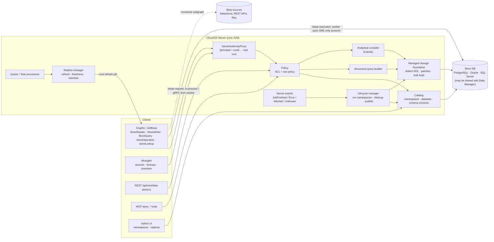
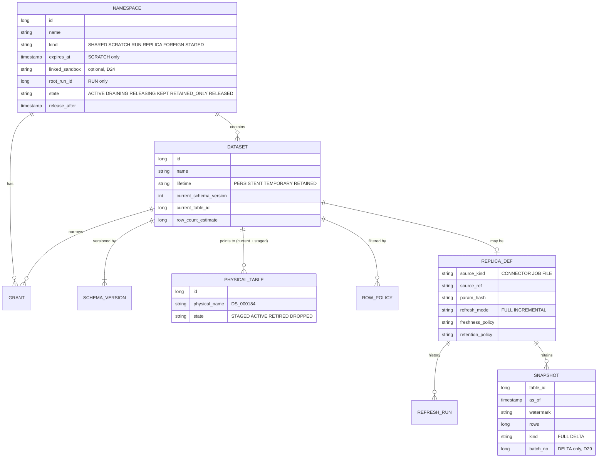
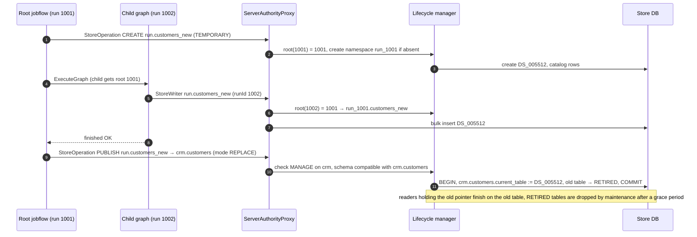
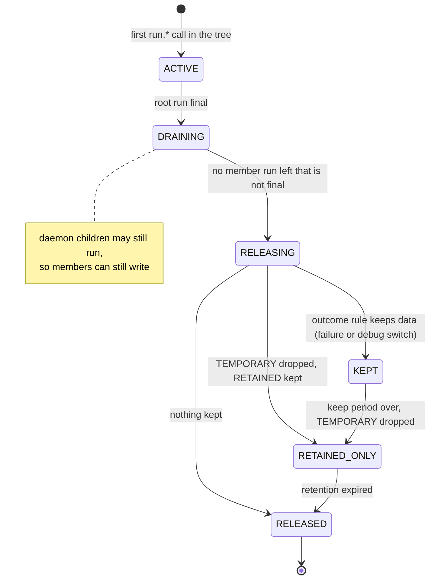
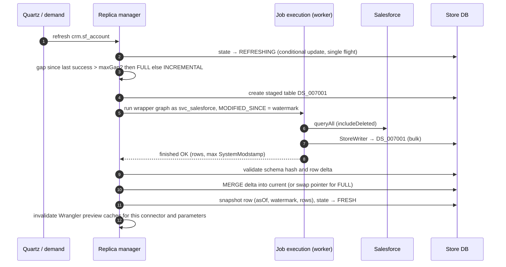
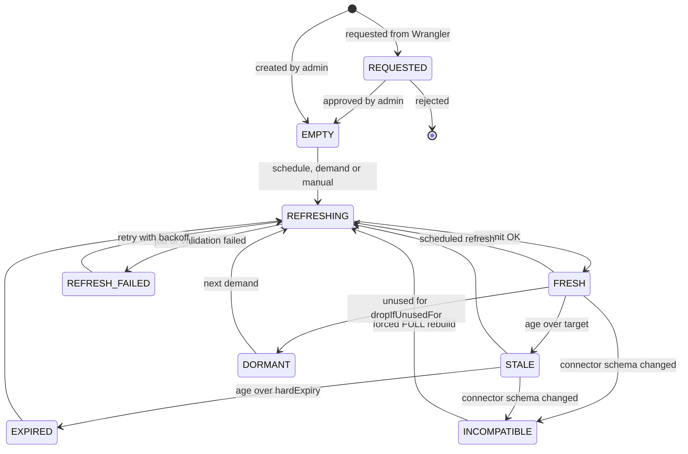
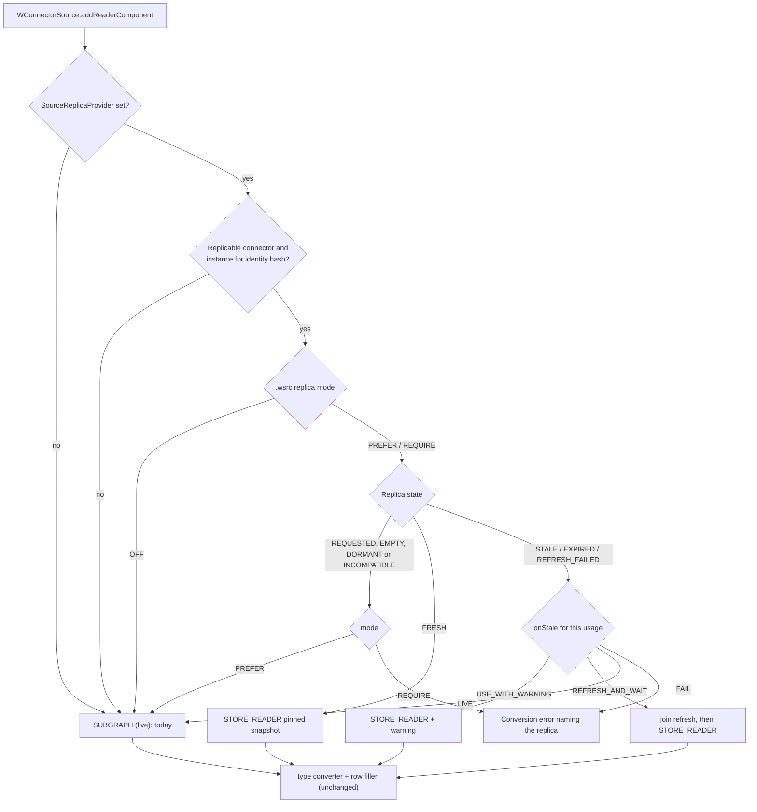
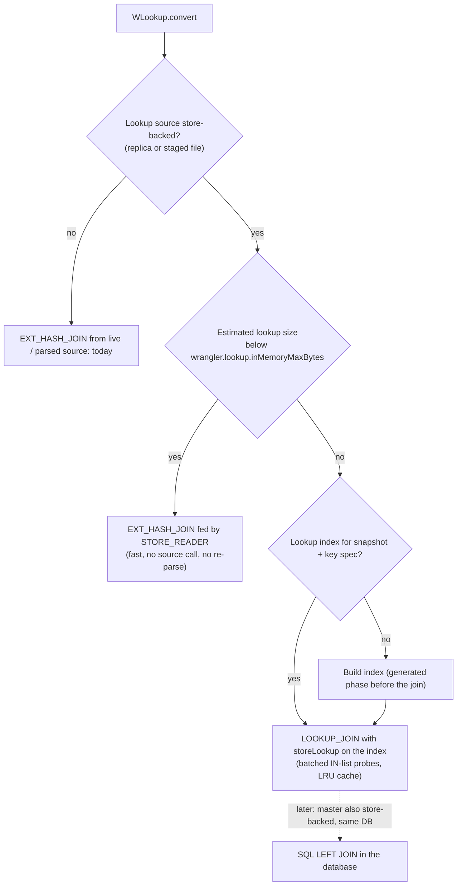
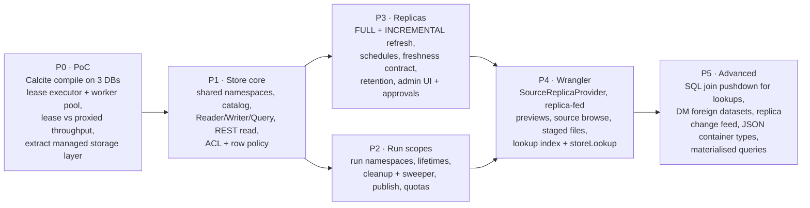

# CloverDX Data Store — Placement, Run Scopes, Replicas and Wrangler Integration

**Status:** Design agreed · 9 November 2026. All 29 decisions in §12 are agreed with the product owner, and every question raised has a decision (§13). Ready for the P0 proof of concept.
**Builds on:** *CloverDX Dataset Store — Technical Specification* (8 November 2026), cited below as **Base §n**.
**Nature:** Design specification. Nothing here is implemented. Names, routes and property keys are proposals.
**Naming:** The Base spec calls the feature *Dataset Store*. It is renamed **Data Store** (D3). Its objects are still called *datasets*.

Conventions:

- **Dn**: a decision. §12 marks each one *decided* (agreed with the product owner) or *proposed* (the author's recommendation, still to be confirmed).
- **Qn**: a question raised during design. §13 shows which decision answered it.
- Code references are repository-relative. `S/` = `cloveretl.server/src/main/java/com/cloveretl/server/`, `E/` = `cloveretl.engine/src/org/jetel/`.

---

## 1. Summary

The Base spec describes a server-hosted store of managed tabular datasets: logical names mapped to RDBMS tables, CloverDX metadata, row policy, REST and graph access, and analytical SQL compiled by Calcite. This document adds four things:

1. **Placement.** The Data Store is a **separate subsystem** from the Data Manager. It shares a refactored storage foundation and can share the Data Manager's database, but has its own model, API, permissions and licence module (§4).
2. **Namespaces and run scopes.** Every dataset lives in a *namespace*. A job tree (a root run and every descendant) gets its own isolated **run namespace**, keyed by `ROOT_RUN_ID`. Temporary datasets in it are dropped when the tree finishes. A dataset built there can be **published** atomically into a shared namespace (§6, §7).
3. **Replicas.** A replica is a store dataset bound to a slow source, such as a Salesforce connector. The connector author declares what can be replicated in `library.json`, and the operator defines instances with a schedule, freshness target, retention and access. Refreshes are validated before they are swapped in, and consumers pin one snapshot per run (§8).
4. **Wrangler.** A Server-side hook in the existing conversion swaps the connector SUBGRAPH for a store reader, leaving the downstream graph unchanged. Source previews can page, sort and filter the full replica server-side. Large lookups run against an indexed store copy that keeps the current first-row-wins semantics, and Excel/CSV lookups are parsed once into a *staged dataset* (§9).

The codebase already has most of the foundation:

- **Calcite 1.41.0 and JSqlParser 5.3 are already Server dependencies.** This removes the main dependency-footprint concern in Base §9.
- The Data Manager already runs a separate managed database (PostgreSQL, Oracle, SQL Server) with per-dialect DDL.
- `ROOT_RUN_ID` already reaches every descendant job.
- Wrangler already has a preview-only source cache keyed by parameter hash, and converts every job on the Server through a `ConversionContext` that a replica hook can join.
- The Salesforce readers already support `includeDeleted` (`queryAll`), which incremental replicas need to see deletes.

---

## 2. Goals and non-goals

**Goals**

- G1. One logical catalog of typed tabular datasets, usable from graphs, jobflows, Wrangler, REST and MCP.
- G2. Isolated, self-cleaning working storage for a job tree.
- G3. Fast, repeatable access to data from sources that are slow, rate-limited or not random-access, with explicit freshness.
- G4. Bounded memory for Wrangler lookups and previews, with no change to Wrangler recipe semantics.
- G5. Policy-enforced reads (ACL plus row policy) on every platform path. Row policy is a hard boundary even against user code in workers (§5.3).

**Non-goals (this iteration)**

- Federated queries across different physical databases (Base §1).
- Change data capture (CDC) from sources. Incremental replicas use source-side watermarks only. The replica change feed (D29) is built from those watermark deltas, not from source logs.
- SCD2 history and "as of T" reads for incremental replicas (Q12).
- Human data stewardship workflows: approval, per-cell audit, staged edits. Those remain the Data Manager's job.
- A replacement for the Wrangler preview cache for plain file sources. It stays (§9.8).
- SQL pushdown of Wrangler recipe steps (D27).

---

## 3. What exists today

Verified against the code on branch `CLO-37527-twin-null-handling`.

| Area | What exists | Where |
|---|---|---|
| Managed data DB | Data Manager uses its **own** datasource (`datamanager.datasource.type` = JDBC / JNDI / remote / empty), separate from the system DB. Data is supported only on PostgreSQL, SQL Server and Oracle. | `S/datamanager/DataManagerConfiguration`, `S/datasource/DataManagerDataSource`, `web/WEB-INF/applicationContext-dataManagerPersistence.xml`, `web/WEB-INF/config.properties` |
| Per-dialect DDL | `SchemaHandler` with Postgre, Mssql and Oracle subclasses. It covers create and drop tables, add and remove columns and indexes, truncate, row limit, quoting and temp tables. `LayoutDiff` handles schema evolution, and each dialect has an exception translator. | `S/datamanager/schema/*` |
| Schema patches | Separate patch stream for the DM database | `S/dbschema/DataManagerDbSchemaUpdate`, `web/WEB-INF/dbpatches/data_manager_db/` |
| DM model | Data set metadata is stored in the system DB (`data_set`, SINGLE_TABLE inheritance with types TRANSACTIONAL and REFERENCE). Data lives in the DM DB, one table per data set (`<code>_data`, `_audit`, `_change`). | `S/persistent/DataSet.java`, `S/datamanager/LocalDataManagerPersistence` (≈4.5k LOC) |
| DM types | BOOLEAN, DATE, DECIMAL(32,10), LONG, STRING, URL | `S/datamanager/DataSetLayout.ColumnMetadataType` |
| DM security | Global `Operation` tree (`data_sets_*`, `data_manager`). Per data set ACL READ_ONLY < EDITOR < APPROVER < ADMIN. **No row-level security.** | `S/facade/api/misc/Operation`, `S/persistent/DataSetPermission*` |
| Graph ↔ server data | DM readers and writers call `IAuthorityProxy` dataset methods. On a worker these go over gRPC to the core, which runs JDBC. | `E/graph/runtime/IAuthorityProxy`, `S/graph/runtime/ServerAuthorityProxy`, `S/worker/ServerAuthorityProxyApiImpl` |
| Design-time metadata | DM readers implement `MetadataProvider`, and `dataSetCode` propagates metadata on update. | `cloveretl.component.commercial/plugin.xml`, `AbstractDataSetReader` |
| SQL libraries | Calcite core/file/linq4j 1.41.0, Avatica, JSqlParser 5.3 | `cloveretl.server/build.gradle`, `version.properties`. Used today in `S/mcp/tool/utils/PerformanceLogsManager` and the MCP DB query validator. |
| Run tree | `run_record.root_run_id` and `parent_run_id` are indexed. `ROOT_RUN_ID` and `PARENT_RUN_ID` are automatic graph parameters in every descendant. `RunRecordFilter.setRootRunId` queries a whole tree. | `S/persistent/RunRecord`, `cloveretl.commons/.../execution/AdditionalJobProperties`, `ExecutionHelper` |
| Job end hooks | `TransformationLifeCycleStrategy.doReleaseEnvironment` (per run). Events `JobFinished`, `JobError`, `JobAborted`, `JobUnknown`. Crash recovery through `solveUnresolvedGraphs` (→ UNKNOWN). **No "tree finished" signal.** Daemon children can outlive the root. | `S/job/graph/`, `S/events/`, `S/graph/LocalExecutionManager` |
| Temp space | One directory per run per node. Not shared by a tree or across nodes. | `S/tempmgr/TempFileManager` |
| Scheduling | Quartz schedules running `Task.TaskType`, including `data_manager_maintenance` → `TaskProcessorDataManager` (retention purge) | `S/persistent/Task`, `S/tasks/TaskProcessorDataManager` |
| Wrangler sources | `.wsrc`: file, Excel, connector (a library `.sgrf` subgraph with one output) or DM data set. Converted to graph components by `W*Source.convert*`. | `E/wrangler/job/model/source/*`, `S/library/LibraryManager` |
| Wrangler cache | Preview only. Binary files in `<workspace>/.cache/` keyed by source id + **parameter hash** + record limit. Max age `wrangler.sourceCache.maxAge=3600`, swept by `GarbageManJob`. Full runs never use it. | `E/wrangler/SourceCacheProvider`, `S/wrangler/WorkspaceCacheProvider`, `S/timing/GarbageManJob` |
| Wrangler lookup | The `WLookup` step compiles to `EXT_HASH_JOIN` (left outer). The whole lookup side is held in memory, with no spill. | `E/wrangler/job/model/step/WLookup`, `cloveretl.component/.../HashJoin` |
| Wrangler preview | Synchronous hidden graph run, read back through edge debug data. `numRecords` only, with no offset or cursor. The UI virtualises a fully loaded set (1k–100k rows). | `S/wrangler/WranglerManager`, `S/facade/api/resp/WranglerDataset` |
| Lookup tables | `simpleLookup`, `dbLookup` (with `maxCached`), `rangeLookup`, `persistentLookup` (JDBM), `referenceLookup` (DM) | `cloveretl.lookup*`, `ReferenceLookupTable` |
| JDBC dialects (engine) | `JdbcSpecific`: type mapping, DDL type strings, quoting. No pagination, MERGE or full CREATE TABLE. PostgreSQL inherits the default type mapping. | `E/database/sql/JdbcSpecific`, `cloveretl.jdbc/.../specific/impl/*` |
| Bulk load | Only external tools (`psql \copy`, `bcp`, `sqlldr`). No JDBC bulk APIs (`CopyManager`, `SQLServerBulkCopy`) anywhere. | `cloveretl.bulkloader` |

---

## 4. Placement relative to the Data Manager

### 4.1 Two different products

| Concern | Data Manager | Data Store |
|---|---|---|
| Primary user | A data steward editing rows in a UI | Jobs, Wrangler, REST and AI agents |
| Unit of work | A row or cell, with status workflow and approval | A set: bulk load, query, swap |
| Volumes | Thousands to low millions, human-reviewable | Millions and up (replicas of CRM objects, staging) |
| Audit | Per-cell audit table for every data set | Per-operation audit (who loaded or queried what). Optional row audit columns. |
| Schema | Six column types. Layout stored as a serialized Java object (`layout_binary`). | Full CloverDX type system, versioned schemas |
| Lifetime | Long-lived, with row retention | Long-lived, run-scoped or replica-managed |
| Access control | Per data set role (READ_ONLY…ADMIN) | Per namespace and dataset ACL **plus row policy** |
| Query | Filter, sort and page on one data set (`RowFilter.toSqlWhereClause`) | Structured reads plus analytical SQL with joins |
| Licensing | Data Manager seats (`getMaxDataManagerUsers`) | `dataStore` module, with optional replica and storage limits, not seats (§5.8) |

### 4.2 Options

| Option | Description | For | Against |
|---|---|---|---|
| **A. Third DM type** | Add `DataSetType.MANAGED` to the DM model | Reuses the UI, ACL, REST, MCP tools and components | 74 `instanceof` checks and 19 `switch` branches on the two existing types. The persistence interface is split by type. Every SQL statement assumes DM system columns. The narrow type model, seat licensing and remote mode (DM data on another server) do not fit run namespaces. Risk to an established product. |
| **B. Separate subsystem, shared foundation** *(recommended)* | New `datastore` subsystem. The general parts of the DM's dialect code, patching, exception translation and datasource plumbing are split out into a shared storage layer that both use. | Clean model. No regression risk to DM. Reuses the proven parts. Same database possible. | Needs one refactoring to extract the shared layer. Two catalogs to present coherently. |
| **C. Fully independent** | New subsystem with its own storage code | No coupling at all | Duplicates `SchemaHandler`, patches and translators. A second managed DB to operate. |

**D1 (decided). Option B.** The Data Store has its own model, API, components, permissions and licence module. It shares a storage foundation with the Data Manager. The code shows what that foundation is, and that it is a **split, not a move**:

| Today (DM) | Shared foundation (`S/managedstorage`) | Stays in DM |
|---|---|---|
| `schema/SchemaHandler` (≈1,000 lines) plus `Postgre`/`Oracle`/`Mssql` subclasses (≈640 lines) | `ManagedSqlDialect`, the general helpers: `canRollbackDDL`, `quote`, `limitRowsStatement` / `rowLimitingClause`, `runWithLockTimeout`, `toTimestamp`, `escapeStringForLike`, boolean literals, temp table DDL, `batchInsertReturningIds`, identifier length, and drop with Oracle `PURGE` (which DM already does) | `SchemaHandler`, now built on `ManagedSqlDialect`: every method that takes a `DataSet`, plus the system, audit, change, lookup and error column layouts (`SystemColumn`, `AuditColumn`, …) |
| `Postgre`/`Oracle`/`MssqlExceptionTranslator` | Moved unchanged | |
| `dbschema/DbSchemaUpdate` (abstract: patch path, dialect, patch table) | Already generic. The store adds `StoreDbSchemaUpdate` with its own patch folder and patch table. | `DataManagerDbSchemaUpdate` |
| `datasource/DataManagerDataSource(Factory)` with retries (`datamanager.datasource.tries`) | A parameterised managed datasource factory | DM configuration keys unchanged |
| `DataSetLayout.ColumnMetadataType` (6 types) | Not shared. The store has its own type model (D6). | Unchanged |

The split lands as the first change of P0, reviewable on its own. **DM behaviour does not change**, as shown by the existing DM unit and integration tests run before and after the split.

**D2 (decided). Own configuration; may share the DM database.** The store has its own datasource configuration (`datastore.datasource.*`). The value `datastore.datasource.type=datamanager` reuses the DM pool and database:

- Store tables use the `DS_` prefix (and `DSR_` for run tables), optionally in their own DB schema.
- The store has its own patch table, so the two patch streams never interfere.
- Sharing is valid only when the Data Manager is configured locally (`DataManagerLocation.LOCAL`). In `REMOTE` mode the DM data lives on another Server and there is no local database to share. A store configured with `type=datamanager` then refuses to start and logs the reason.
- Co-location is what makes §4.3.1 possible, because the query compiler executes in a single database (Base §1). With separate databases, everything except joins with DM data still works.

### 4.3 Integration points with the Data Manager

These keep the two subsystems loosely coupled while looking like one product:

1. **DM reference data sets as read-only foreign datasets** (later phase, needs D2 co-location; referred to as §4.3.1). When DM and the store share a database, the catalog can expose a reference data set as `dm.<code>`: a logical dataset whose physical scan is the DM `_data` table under a fixed policy (`_enabled` rows within validity). Dataset SQL can then join store data with stewarded reference data. Writes stay in DM.
2. **Data Catalog.** `S/datacatalog/DataCatalog` (the Wrangler source and target catalog) gets a third provider, *store datasets*, next to connectors and DM data sets.
3. **Publishing into DM.** A job can still move store data into a transactional DM data set for human review using today's DM writer. No new coupling is needed.

**Naming.** "Data set" is already taken by the Data Manager everywhere:

- the `DataSet` entity
- `/data-sets` routes
- the *Data Sets* web app
- the `dataset_*` MCP tools (CLO-37003 onwards)
- the `DataSet*Reader/Writer` components

DM data sets also already appear as Wrangler sources and targets. A second, unqualified meaning would confuse users, support staff and AI agents.

**D3 (decided, Q1).** The feature is called **Data Store**. Its objects keep the name **datasets**. These rules keep the two apart:

| Where | Rule |
|---|---|
| Any UI, doc or message where both kinds can appear (Wrangler source and target picker, Data Catalog, MCP tool descriptions, error messages) | Always qualified: **"Data Store dataset"** versus **"Data Manager data set"**, listed under separate headings. Spelling alone (*dataset* versus *data set*) is never relied on. |
| Store-only screens and docs | "dataset" alone is fine |
| Machine names | Always the `store` / `datastore` prefix, never `dataset`: package `datastore`, REST `/api/rest/data-store/v1`, permissions `data_store_*`, MCP `store_*`, components `StoreReader` / `StoreWriter` / `StoreQuery` / `StoreOperation` (type ids `STORE_READER`, …), lookup type `storeLookup`, config `datastore.*` |
| Glossary | One entry for each term, cross-referenced, in the user guide and the knowledge base the AI tools read |

All of these machine names are free today. The only "data store" in the codebase is the profiler's internal `LargeDataStoreProvider`.

---

## 5. Architecture

### 5.1 Placement in the codebase

| Piece | Location (proposed) | Pattern followed |
|---|---|---|
| Catalog, namespaces, policy, lifecycle, replicas | `S/datastore/**` (Spring context `applicationContext-dataStore.xml`) | `S/datamanager/**` |
| Shared storage foundation | `S/managedstorage/**`, extracted from `S/datamanager/schema` | D1 |
| SQL compilation | `S/datastore/query/**` using Calcite (already on the classpath) | `PerformanceLogsManager` (existing Calcite use) |
| Public REST | `web/WEB-INF/rest/data-store/v1/data-store-openapi.yaml`, generated module `cloverdx.server.rest-datastore`, controllers `S/api/restdatastore/v1` | Public DM REST |
| MCP tools | `S/mcp/tool/{descriptor,catalog}/datastore`, new `ToolCategory` or reuse of `DATA_MANAGER`'s gate pattern | CLO-37003 |
| Engine contract | New `IAuthorityProxy` methods that return leases, plus DTOs and the lease executor in `E/datastore/*`. Lease requests from workers go through `ServerAuthorityProxyApi`. Proxied fallback for row-policy datasets and `lease.mode` | DM `IAuthorityProxy` methods, `worker.jndi.datasource` |
| Components | `cloveretl.component.commercial`: `StoreReader`, `StoreWriter`, `StoreQuery`, `StoreOperation` | DM readers and writers |
| Lookup | `cloveretl.lookup.commercial`: `storeLookup` | `ReferenceLookupTable` |
| Wrangler | `SourceReplicaProvider` in `E/wrangler` (Server implementation in `S/wrangler`), `STORE_READER` emitted by `WConnectorSource`, `WStoreSource` / `WStoreTarget`, lookup index and staging in the source and step conversion | `SourceCacheProvider`, `WDataSetSource` |
| CTL functions | `cloveretl.ctlfunction.commercial`: `storeExists`, `storeRowCount`, `storeAsOf`, `storeState` (D28) | Existing commercial CTL function libraries |
| Web UI | `cloverdx.frontend/cloverdx.webapps/src/server/data-store/` (admin: namespaces, replicas, freshness) | `src/server/data-sets` |
| Scheduling | `Task.TaskType.datastore_replica_refresh`, `datastore_maintenance` | `data_manager_maintenance` |

### 5.2 Component view



### 5.3 Data plane: how records travel

Today DM components send every record through `IAuthorityProxy`. For a worker, that means a gRPC hop to the core, which runs JDBC. This is fine for DM volumes. It would be the bottleneck for replica loads and large reads.

| Mode | Path | Security | Throughput |
|---|---|---|---|
| **Direct lease** | The core compiles the statement (ACL checked, row policy applied, physical names resolved) and hands the worker a **lease**. The worker executes the lease on a worker-local connection pool. | Store DB credentials sit in the worker JVM, where user Java code also runs (see the trust boundary below) | Native JDBC and bulk APIs |
| **Proxied** | Worker ⇄ gRPC (record blocks in CloverDX binary format) ⇄ core ⇄ JDBC | Credentials never leave the core | Bounded by the core |

**D4 (decided). Direct lease from the start. Proxied mode remains for what must not be leased.**

**The lease** is a short-lived, single-use object the core issues per component and statement. It holds:

- the compiled SQL and its bind values, with the row policy already in the statement
- the pinned physical tables (snapshot pinning, §8.6)
- the operation kind (read, append, upsert, bulk load)
- the run id
- an expiry

The worker executes exactly that statement. It never builds SQL from logical names, and it never sees the catalog. A job on the core JVM uses the same lease, executed in process.

**Worker connections** follow the existing pattern for giving workers pooled DB connections (`worker.jndi.datasource[n].*`, with drivers in `worker.classpath`, by default `${clover.home}/worker-lib`). The store configures a worker datasource for its DB automatically, from its own settings. The store DB's JDBC driver must therefore be present in the worker classpath, and the server checks this at worker start.

**Two DB accounts:**

- The **owner** account is used only by the core. It runs DDL, catalog writes, swaps and maintenance.
- The **worker** account can only select, insert, update and delete on store data tables. It has no DDL rights and no rights on catalog tables. A worker therefore cannot drop tables, alter schemas or move a dataset's current-table pointer.

**Trust boundary.** In lease mode, ACL and row policy bind every platform path: components, Wrangler, REST and MCP. Arbitrary user code running in a worker (a Java transform, a custom component) could open the worker pool itself and read or change any table the worker account reaches. This is the same trust level as graph DB connections today, whose credentials are also in the worker. Three rules keep the hard boundaries where they matter:

1. **Datasets with a row policy are never leased.** The worker account has no grant on their tables, and they are always served proxied. Row policy therefore stays a hard boundary, even against user code.
2. **`datastore.lease.mode`** (`ALL` | `SYSTEM_JOBS` | `OFF`, default `ALL`) lets a deployment that needs ACL as a hard boundary restrict leases:
   - `SYSTEM_JOBS`: only replica refresh, staging and lookup-index builds are leased
   - `OFF`: everything is proxied
3. **The worker account's grants are managed by the core** on each table's creation, drop and policy change. They never include catalog, audit or DM tables.

The proof of concept still measures both modes on a 10M-row load, so the cost of `OFF` is known to administrators who choose it.

**Bulk load** uses the JDBC bulk APIs inside the lease executor:

- `CopyManager` for PostgreSQL
- `SQLServerBulkCopy` for SQL Server
- array binding or direct-path for Oracle

They are new to the codebase, and they run in the worker against the driver in `worker-lib`.

### 5.4 Where the catalog lives

The Data Manager keeps metadata in the **system DB** and data in the DM DB. The store has different needs:

- run namespaces create and drop tables at high rates
- publish and replica swaps must change the catalog pointer and the physical table together

**D5 (decided).** The store catalog lives in the **store DB**, next to the tables, so pointer swaps and DDL commit together where the dialect allows it:

- PostgreSQL: transactional DDL
- SQL Server: mostly transactional
- Oracle: DDL auto-commits, so swap uses a two-phase protocol with a recoverable `SWAPPING` state

Users, groups and run records stay in the system DB and are referenced by id. A repair task reconciles catalog rows with physical tables (orphans in either direction).

### 5.5 Type model

**D6 (decided). Scalars first, containers later.** Store columns carry CloverDX field types, not the DM's six types. From P1:

- string, integer, long, number, decimal(p,s), boolean
- date, which maps to a UTC timestamp (D26)
- byte and cbyte

**From P5: list, map and variant**, mapped to JSON:

- PostgreSQL: `jsonb`
- SQL Server: `nvarchar(max)` with an `ISJSON` check
- Oracle: `JSON` or `CLOB`

They come only after their mapping, null handling and SQL behaviour have been proven on all three databases. Until then, a writer whose metadata contains a container field is refused with a message naming the field. Graphs flatten or serialise containers first.

Logical metadata (field name, label, nullability, default, precision and scale, format hints) is stored as a **versioned schema** with a monotonic version number. Writers state the version they expect. A mismatch either fails or, for additive changes, upgrades with `LayoutDiff`-style DDL.

Type mapping is owned by the managed storage foundation, not by the engine `JdbcSpecific`. The DM already does this, and `PostgreSpecific` has no type mapping of its own.

**D26 (decided, Q4). Dates are stored as UTC in a plain timestamp.** A CloverDX `date` is an instant with millisecond precision. Its per-field `timeZone` metadata is used only for formatting.

| Database | Column type |
|---|---|
| PostgreSQL | `TIMESTAMP(3)` |
| SQL Server | `DATETIME2(3)` |
| Oracle | `TIMESTAMP(3)` |

- **Writing and reading** go through the storage foundation and always state UTC explicitly: `setTimestamp`/`getTimestamp` with a UTC `Calendar`, or `LocalDateTime` in UTC. The JVM's default time zone never takes part.
- **Why not copy the Data Manager.** The Data Manager writes `new Timestamp(epochMillis)` with no calendar (`SchemaHandler.toTimestamp`). With standard JDBC behaviour, its stored wall time therefore depends on the JVM's time zone, and could shift if that changes or if cluster nodes differ. The store does not inherit that.
- **The field's `timeZone` is kept** in the logical schema, so metadata served to graphs and Wrangler formats as it did at the source.
- **Dataset SQL** (Base §5) reads date literals and comparisons as UTC. The query documentation says so, with an example of filtering by a local calendar day.
- **DM foreign datasets** (§4.3.1) are the one place the two conventions meet. Their scan mapping converts the DM's JVM-zone wall time to UTC, so a join between store and DM dates compares instants.

### 5.6 Security

**Principals.**

| Caller | Principal |
|---|---|
| REST or MCP | The authenticated user |
| Graph | The run's executing user. The server resolves it from `runId` and never trusts a value the job supplies. |
| Replica refresh | The replica's *refresh principal* (§8.8) |

**Global permissions.** New branch of `Operation`:

```
data_store_all
 ├─ data_store_admin        (manage namespaces, replicas, policies)
 ├─ data_store_create       (create datasets in namespaces where granted)
 └─ data_store_use          (read/write per ACL; required for components and REST)
```

**Object ACL.** Grants are on the namespace and are inherited by its datasets. A dataset can narrow them. Grants come from two sources (D24):

- **Explicit grants** to users or groups
- **Derived grants** from a linked sandbox or Wrangler workspace (§6.1)

| Level | Allows |
|---|---|
| `READ` | Schema, structured read, SQL |
| `WRITE` | Insert, update, delete, truncate |
| `MANAGE` | Create, drop, alter, publish into |
| `ADMIN` | Grants and policies |

**Row policy.** As in Base §7. A policy is a predicate over logical fields and principal attributes:

- `user.name`
- `user.groups`
- user properties
- for a run, its sandbox and job file

The policy is compiled below every scan.

**Run namespaces bypass object ACL, not row policy.** Inside its own run namespace a job tree is `ADMIN`. Data read *from* shared namespaces keeps its row policy even after being copied into the run namespace, because the policy was applied when it was read. Publishing *out* requires `MANAGE` on the target namespace.

### 5.7 Configuration (proposed keys)

```properties
datastore.enabled=false
datastore.datasource.type=            # JDBC | JNDI | datamanager | empty (disabled)
datastore.datasource.jndiName=
datastore.jdbc.driverClassName=
datastore.jdbc.url=
datastore.jdbc.username=
datastore.jdbc.password=
datastore.jdbc.worker.username=       # DML-only account used by leases in workers (§5.3)
datastore.jdbc.worker.password=
datastore.lease.mode=ALL              # ALL | SYSTEM_JOBS | OFF (§5.3)
datastore.lease.ttl=PT10M
datastore.tablePrefix=DS_
datastore.run.retainOnFailure=PT24H   # how long a kept tree's TEMPORARY data stays (§7.7)
datastore.run.retainedDefault=P7D     # retention of RETAINED run datasets unless the dataset sets its own (§7.3)
datastore.run.drainWarnAfter=PT6H     # report a namespace still DRAINING (daemon child) after this
datastore.run.schema=                 # optional separate DB schema for run tables (§7.11)
datastore.scratch.maxTtl=P7D          # longest TTL a scratch namespace may ask for (§7.9)
datastore.run.defaultQuota.rows=
datastore.run.defaultQuota.bytes=
datastore.query.timeout=PT5M
datastore.query.maxRows=
datastore.replica.maxConcurrentRefreshes=4
datastore.staged.maxBytes=            # storage budget of the staged namespace (LRU)
datastore.staged.idleTtl=P14D
datastore.maintenance.interval=PT5M
wrangler.lookup.inMemoryMaxBytes=      # above this a lookup uses the lookup index (§9.5)
wrangler.staging.mainSourceMinBytes=   # main file sources at least this large are staged (§9.6)
```

### 5.8 Licensing

**D25 (decided, Q2). A module flag, plus optional limits.** Seat-based licensing, like the Data Manager's, does not fit machine use.

| Licence element | Meaning | Enforcement |
|---|---|---|
| `LicenseModules.dataStore` ("Data Store") | Gates the feature: components, REST, MCP, Wrangler integration, admin UI | Same pattern as `DataSetManager.requireDataManagerLicense()`. Without it, store calls fail with a licence message, and Wrangler behaves as if no replicas existed. |
| `maxDataStoreReplicas` (optional) | Number of replica instances in states other than `REQUESTED` | Approving or creating one more is refused. Existing replicas keep refreshing. |
| `maxDataStoreBytes` (optional) | Total stored size across all namespaces (shared, scratch, run, replica, staged), from catalog statistics | A warning at 90 %. Above 100 %, writes that grow storage are refused, except replica refreshes of existing replicas. Reads, drops and truncates always work. |

When a limit is absent, it does not apply. Packaging can therefore change in the licence file without code changes. The limits are a new kind of licence property, next to the seat counts in `LicenseMaxUserCounts` but not a user count, and are read by `LicenseBean`.

---

## 6. Namespaces

The Base spec leaves name scoping open (Base §11, "Catalog and lifecycle"). This spec makes the **namespace** the unit of isolation, ACL and lifecycle.

| Kind | Name | Created by | Lifetime | Visibility |
|---|---|---|---|---|
| **Shared** | `crm`, `finance`, … (admin-chosen) | Admin, or a user with `data_store_create` | Until dropped | ACL |
| **Run** | Addressed as `run`, stored as `run_<rootRunId>` | Automatically, on first use within a job tree | Tree lifetime (§7) | The tree's runs while it runs. Afterwards, kept data is read-only for users who may see the root run in the execution history, and for admins (§7.3). |
| **Scratch** | Chosen by the creator, e.g. `tmp_<rootRunId>` | A job (`StoreOperation CREATE_NAMESPACE`) or a user, with `data_store_create` | Its TTL, at most `datastore.scratch.maxTtl` | ACL set at creation; the creator is `ADMIN` |
| **Replica** | `replica` (system-owned), or a shared namespace chosen per replica | Replica manager | Replica retention (§8.7) | ACL on the replica |
| **Foreign** | `dm` | System | Mirrors DM | DM ACL mapped to `READ` |
| **Staged** | `staged` (internal, not addressable by name) | Wrangler conversion | LRU and idle TTL (§9.6) | Re-checked against the original file or snapshot on every use (§9.5, §9.6) |

Addressing: `namespace.dataset` everywhere (components, REST, SQL). `run.x` always means the caller's own tree. An unqualified name is an error. There is no search path, so a temporary table never silently shadows a shared one.

### 6.1 Linking a namespace to a sandbox (D24)

**D24 (decided, Q3). Namespaces have their own ACL, plus an optional link.** An admin can link a shared or scratch namespace to **one** sandbox or Wrangler workspace. The link adds grants derived from that sandbox's permissions, so teams organised by sandbox don't administer permissions twice.

| Linked permission | Derived namespace grant |
|---|---|
| Sandbox `read` | `READ` |
| Sandbox `write` | `WRITE` + `MANAGE` |
| Sandbox `execute` | None. Running jobs does not imply data access. |
| Workspace `VIEWER` | `READ` |
| Workspace `EDITOR` | `WRITE` + `MANAGE` |
| Workspace admin | `WRITE` + `MANAGE` |

Rules for links:

- `ADMIN` on a namespace (grants and policies) is never derived. It comes only from an explicit grant or `data_store_admin`.
- **Derived grants are evaluated at check time, not copied.** A change to the sandbox's permissions applies to the namespace immediately. Removing the link removes the derived grants.
- The effective permission is the union of explicit and derived grants. Row policy applies on top of either, as always.
- **Names stay global.** A link does not make `ns.dataset` resolve differently per sandbox. For portability between dev, test and prod, jobs use parameters (`${CRM_NS}.customers`).
- **Deleting the sandbox drops the link, never the namespace.** Store data is not deleted as a side effect. The namespace is reported as unlinked.
- **Configuration export and import** (the server config JAXB model, as for DM data sets) carries namespace definitions, explicit grants and the link by sandbox code. Data is never exported.
- **Wrangler convenience.** A workspace's linked namespace is offered as the default target namespace in Wrangler. This only suggests a target; it does not change name resolution.

### 6.2 Catalog model



A dataset points to a **current physical table**. All atomic operations work by moving that pointer:

- publish
- full replica refresh
- schema migrations that need a rewrite

Readers resolve the pointer once per statement, so they always see one consistent version.

---

## 7. Run-scoped namespaces

### 7.1 Requirements

- R1. A top-level job and all its descendants (ExecuteGraph, ExecuteJobflow, subgraphs, Wrangler jobs) share one namespace, isolated from every other run.
- R2. Jobs in the tree can create, alter, write, read and drop datasets in it, and can also work with shared namespaces under normal ACL.
- R3. Temporary datasets disappear when the tree finishes, including after a crash.
- R4. Results built in the run can be made visible to others atomically.
- R5. It works when children run on other cluster nodes or in worker JVMs.
- R6. A run that never uses the store pays nothing.
- R7. After a failure, the data can be inspected long enough to debug it.

### 7.2 Membership and identity

**Rule.** The namespace key is the tree's root run id: `root(run) = run_record.root_run_id ?? run.id`.

A root job's own run record has `root_run_id = null`. Every child gets *parent's root ?? parent's id* when its execution command is prepared:

- `ServerAuthorityProxy.prepareExecutionCommand` and `prepareWranglerExecutionCommand`
- `MasterStartingStrategy` (partitioned cluster graphs)
- `WranglerJobStartingStrategy`

`ExecutionHelper` fills the `ROOT_RUN_ID` graph parameter by the same rule, so a job sees the same value the store uses.

Which start paths join which tree:

| Start path | Namespace | Notes |
|---|---|---|
| Schedule, event listener, REST, SOAP, HTTP API, Server Console, Designer "run on Server" | Its own tree, as root | |
| ExecuteGraph, ExecuteJobflow, ExecuteWranglerJob, WranglerJob component | The parent's tree | Daemon children included |
| Subgraph component | The parent's run | |
| Partitioned cluster graph (worker partitions on several nodes) | The master's tree | |
| Data service request (Data App, `RESTJOB`) | **None**: `run.*` is refused in the whole tree | §7.10 |
| Hidden execution (`persistentRunRecord = false`: Wrangler previews, profiler) | The caller's tree when started from a run. Otherwise `run.*` is refused. | It has no run record in the DB, so the sweeper cannot see it. This is acceptable because such runs are synchronous children (`executeGraphSync`), so their parent always outlives them. Wrangler staging uses the `staged` namespace, never `run`. |
| A job started *because of* another tree: a jobflow or file event listener, or an HTTP call made by a job | **Its own tree**. It is not a member. | Sharing data with it is covered in §7.9. |

**Resolution in the core.** Every store call arrives through `ServerAuthorityProxy`:

- in process, it holds the calling run's runtime environment
- from a worker, the gRPC API carries `runId`, and the core finds the environment among its running jobs

The root is read from that environment, with no DB lookup per call. The caller never names its namespace, which guarantees isolation: a job cannot reach into another tree's namespace by guessing its id.

**Lazy creation (R6).** The namespace row is created on the first `run.*` reference, by a conditional insert on the unique root id. Concurrent first calls from parallel children are safe. A tree that never says `run.` costs nothing.

### 7.3 Dataset lifetimes inside a run namespace

| Lifetime | Behaviour at tree end | Use |
|---|---|---|
| `TEMPORARY` (default in `run`) | Dropped, subject to the tree outcome rule (§7.7) | Staging, intermediate results, lookups |
| `RETAINED` | Kept, read-only, for a retention period (per dataset, default `datastore.run.retainedDefault`) | Run outputs worth inspecting, audit evidence |
| `PUBLISHED` (an action, not a state) | The physical table is moved into a shared dataset (§7.4). Nothing is left in the run namespace. | Build-then-swap |

**After the run**, a retained or kept dataset is addressable read-only as `run_<rootRunId>.x` by:

- users who may see that root run in the execution history (the same permission as its log and tracking)
- holders of `data_store_admin`

An admin can also **publish a retained dataset after the run**, for example to promote the output of a run that failed only at its final step.

Writes to **shared** datasets from inside a run are ordinary writes. They are not undone if the tree fails. All-or-nothing behaviour comes from publish, not from distributed transactions.

### 7.4 Publish: build in isolation, swap atomically



Publish modes:

- `REPLACE`: pointer swap
- `APPEND`: `INSERT … SELECT` inside the DB
- `MERGE`: upsert by key, inside the DB

`REPLACE` is the only one that is O(1) and atomic on every dialect.

### 7.5 Namespace lifecycle

A run is final when its `Result.isStop()` is true: `FINISHED_OK`, `ERROR`, `ABORTED`, `TIMEOUT` or `UNKNOWN`.



### 7.6 Detecting that a tree has finished

The platform has no "tree finished" signal, and daemon children can outlive the root. The design combines an event trigger with a sweeper:

1. **Event trigger.** A `ServerEventListener` receives job end events (`JobFinished`, `JobError`, `JobAborted`, `JobUnknown`, timeout) and resolves the run's root.
   - If the run is the root, the namespace moves to `DRAINING`.
   - In either case, if the namespace is `DRAINING`, the listener checks for members still running: `id = R OR root_run_id = R`, with a status that is not final (`RunRecordFilter.setRootRunId`; `root_run_id` is indexed). If there are none, the namespace moves to `RELEASING`.
2. **Sweeper.** The `datastore_maintenance` task (the `TaskProcessorDataManager` pattern) re-evaluates `ACTIVE` and `DRAINING` namespaces whose root is final. This covers:
   - lost events
   - cluster failover
   - runs moved to `UNKNOWN` by `solveUnresolvedGraphs` after a crash
3. **Cluster safety.** State changes are conditional updates (`… SET state='RELEASING' WHERE id=? AND state='DRAINING'`). Only the node whose update wins drops the tables, so no cluster lock is needed.
4. **Orphans.** If a namespace's root run record is gone (run history purged), the sweeper releases it. This mirrors temp-space `sanitizationCleanup`.
5. **A daemon child that never ends** keeps its namespace in `DRAINING`. Tables are never dropped under a running member. Instead:
   - after `datastore.run.drainWarnAfter`, the namespace is reported in the admin UI and the log
   - an admin can abort the daemon, or release the namespace by force; the daemon's next store call then fails with "run namespace released"

### 7.7 Tree outcome and keeping data for debugging (Q6)

**D21 (Q6). The tree counts as failed if *any* member run ended `ERROR`, `ABORTED`, `TIMEOUT` or `UNKNOWN`**, even when the root handled the failure and finished `FINISHED_OK`. A failed tree keeps its `TEMPORARY` data for `datastore.run.retainOnFailure` (state `KEPT`), so failures the root handled stay debuggable with their data. A tree with no failed member drops it at once.

The outcome is computed at `RELEASING` from the members' run records (the same `root_run_id` query as §7.6), so no member needs to report anything.

Two switches adjust that rule:

- **Per dataset: `keepOnFailure`**, default `true`, set on `StoreOperation CREATE` and on `StoreWriter createIfMissing`. Setting it to `false` drops a large intermediate dataset even in a failed tree, when keeping it is not worth the space. A dataset that must survive even a successful run uses the `RETAINED` lifetime instead.
- **Per job: the job config property `datastore.run.keepNamespace`** (`NEVER | ON_FAILURE | ALWAYS`, default `ON_FAILURE`), set on the root job. It is read through the existing per-job configuration (`JobConfigDataSourceFactory`, which already serves the job log level, for example).
  - `NEVER` drops everything at tree end.
  - `ALWAYS` is the debugging switch: everything is kept for `datastore.run.retainOnFailure`, whatever the outcome.

### 7.8 Concurrency inside a tree

Parallel children often write the same dataset.

| Concern | Rule |
|---|---|
| Create | `CREATE IF NOT EXISTS` with a schema equality check. Two children creating the same dataset with the same schema both succeed. Different schemas fail. |
| Append | Concurrent appends allowed, in separate transactions |
| Replace or truncate | Takes a dataset write lock (catalog row lock). Concurrent appends wait or fail per `lockTimeout`, reusing the DM's `SchemaHandler` lock-timeout support. |
| Schema change | Exclusive lock. Bumps the version. Writers holding an older version fail fast. |
| Read-your-writes | A writer's commit (per batch or at component end, configurable like `DBOutputTable`'s commit) makes rows visible to siblings |

### 7.9 Sharing with jobs outside the tree (Q5)

Some orchestrations leave the ExecuteGraph tree. A jobflow can finish and trigger another job through an event listener, call a Data Service over HTTP, or start a job through REST. Those jobs are roots of their own trees (§7.2). Three ways to let them see the data:

| Option | How | For | Against |
|---|---|---|---|
| **A. Strict tree** | Not possible. Use ExecuteGraph, or publish into a shared namespace. | Simplest. No new trust model. | Event-driven designs must publish into a long-lived shared namespace and clean up themselves |
| **B. Join token** | The root obtains a token bound to its namespace and user, and passes it as a job parameter. The started job presents it and is recorded as a member, so `DRAINING` also waits for it. | Real membership, cleanup covers the joined job | A bearer secret in job parameters, which the execution history displays. Needs signing, expiry and same-user rules. |
| **C. Scratch namespaces** | `StoreOperation CREATE_NAMESPACE tmp_${ROOT_RUN_ID} ttl=P1D grant=…` creates a **scratch** namespace (§6): shared by name, with a time-to-live and an ACL. Any job with access uses it by name. Maintenance drops it when the TTL expires. | Normal ACL, no secret. Also useful outside run trees. | No membership: cleanup is by TTL, not by tree end |

**D20 (Q5). Option C now, option B later.** Scratch namespaces ship with run namespaces:

- **Creation.** `CREATE_NAMESPACE` is idempotent for the same creator and name, so a retried jobflow does not fail. The TTL can be extended (`EXTEND_TTL`) and the namespace dropped early (`DROP_NAMESPACE`).
- **Contents.** Datasets in a scratch namespace are `PERSISTENT` within it. They live as long as the namespace does.

So that a join token (option B) can be added later without a migration, membership is modelled now as a `NAMESPACE_MEMBER` relation:

- **Today the relation is derived:** the members are the runs whose root is the namespace's root.
- **The `DRAINING` check reads it through one query.** A later explicit member row (a run that joined with a token) is then also waited for, with no change to the lifecycle.

### 7.10 Data service requests (Q19)

A Data App or Data Service request is a root of its own (`RESTJOB`), and such requests can arrive many times a second. If a data service uses `run.*`, every request creates and drops tables. That is DDL churn on the store DB and catalog bloat on PostgreSQL. Lazy creation (§7.2) means a data service that does not use `run.*` costs nothing.

**D23 (Q19). `run.*` is refused in data service trees.** A tree whose root is a `RESTJOB` gets no run namespace, and that includes its children (the root is recognised the way `JobQueue.isChildOfDataService` does it). The error names the alternatives:

- a shared namespace, for data the service reads or maintains
- a scratch namespace with a short TTL, for data that must outlive one request

Ordinary quotas apply to both. This keeps the load a busy Data App puts on the store DB predictable.

### 7.11 Physical storage

Run tables use their own name prefix (`DSR_`) and, where configured, a separate DB schema. Maintenance and space accounting can then treat them apart from shared data.

| Dialect | `TEMPORARY` tables | Drop |
|---|---|---|
| PostgreSQL | `CREATE UNLOGGED TABLE`: no WAL, much faster loads. An unlogged table is emptied after a database crash. That is acceptable for temporary data: the runs writing it end as `UNKNOWN`, and a kept table after a DB crash is simply empty. A `RETAINED` table is logged (`ALTER TABLE … SET LOGGED` when it is retained). Heavy create and drop bloats `pg_class`, which autovacuum handles. Quotas limit the rate. | `DROP TABLE` |
| Oracle | Ordinary table. `NOLOGGING` with direct-path bulk loads where the DBA allows it. | `DROP TABLE … PURGE`. Without `PURGE`, dropped tables stay in the recycle bin and keep their space. |
| SQL Server | Ordinary table. `tempdb` and `#temp` tables cannot be used, because they are tied to one session, and the members of a tree use many connections. | `DROP TABLE` |

### 7.12 Quotas

Per run namespace: maximum datasets, rows and bytes (`datastore.run.defaultQuota.*`, overridable per sandbox and per job config). Byte usage comes from catalog statistics refreshed on commit. Rows are counted exactly at write time. Exceeding a quota fails the write with an error naming the quota. This is new: the job queue tracks only CPU and heap.

### 7.13 Visibility in the execution history

The execution detail of a root run (`ExecutionTreeController`, the execution tree view) gets a **Data** tab:

- namespace state and the datasets in it
- each dataset's lifetime, rows, size and the member run that created it
- for kept and retained data, the date it will be dropped

Actions there: *release now*, *extend retention*, *publish* (admin). This view lets people debug with the data, not just the log.

### 7.14 Designer and local runs

The store follows the Data Manager precedent:

- For a Server project, `GuiAuthorityProxy` asks the Server for design-time information (metadata).
- In a local execution, data calls fail with "Using Data Sets is not possible in local executions" (`PrimitiveAuthorityProxy`).

**D7 (decided).** Store metadata is available at design time for Server projects. Store data is accessed only in runs on the Server.

**Run datasets have no design-time catalog entry**, because they exist only while a tree runs. A `StoreReader` of `run.x` therefore takes explicit metadata. The idiomatic pattern is one external `.fmt` shared by the writer that creates `run.x` and every reader. `StoreOperation CREATE` can take that same metadata. A future improvement could propagate the writer's metadata through the jobflow, but that is not proposed now.

**D22 (Q7). No embedded local store.** Graphs that use the store run on the Server. A local run fails with a clear message, as Data Manager graphs do today. That leaves no second SQL dialect to keep in step with PostgreSQL, Oracle and SQL Server.

---

## 8. Replicas (shadow datasets)

### 8.1 Concept

A **replica** is a store dataset whose content is owned by a **source binding**, not by user writes. The replica manager keeps it within a freshness target by running a refresh job, and records *how fresh* it is. Consumers state *how fresh it must be*.

| Kind | Source reference | Typical example | Section |
|---|---|---|---|
| `CONNECTOR` | Library code, connector path and parameter values (the Wrangler connector: a `.sgrf` with no input and one output) | Salesforce Account object | §8.2–§8.9 |
| `JOB` | Any graph or subgraph with one output port, plus parameters | A custom REST extraction | Same as `CONNECTOR`, with the capability given in the instance |
| `FILE` | URL plus parser settings and metadata. Freshness is a file **fingerprint**, not a clock. | Excel lookup table | §9.6 (*staged datasets*) |
| `QUERY` | Dataset SQL over other store datasets (materialised view) | Dashboard aggregates | Later phase (Base §11) |

### 8.2 Two layers: connector capability and replica instance

Only the connector's author knows which parameter carries a "modified since" value, which output field is the change watermark, how deletes show up, and which parameters do not affect content. The operator decides how often to refresh, how long to keep data, and who may read it. The spec separates the two.

**Capability**: declared by the connector author in the library's `library.json`. It is an optional `replica` object beside the existing connector entry in `publicInterface.dataConnectors.sources[]`, so it is versioned with the library:

```json
{
  "path": "graph/subgraph/SalesforceObject.sgrf",
  "description": "Reads one Salesforce object",
  "replica": {
    "replicable": true,
    "key": ["Id"],
    "incremental": {
      "watermarkField": "SystemModstamp",
      "watermarkParameter": "MODIFIED_SINCE",
      "deletes": { "mode": "TOMBSTONE", "flagField": "IsDeleted", "maxGap": "P14D" }
    },
    "parameters": {
      "OBJECT": "identity",
      "FIELDS": "identity",
      "WHERE": "identity",
      "BATCH_SIZE": "volatile",
      "TIMEOUT": "volatile"
    },
    "defaults": { "freshnessTarget": "PT24H", "hardExpiry": "P7D", "schedule": "0 0 1 * * ?" }
  }
}
```

**Instance**: a row in the store catalog. It names the connector and the concrete parameter values, and holds the operational policy:

```yaml
replica: crm.sf_account               # dataset name (namespace.dataset)
source: { kind: CONNECTOR, library: salesforce, connector: graph/subgraph/SalesforceObject.sgrf,
          parameters: { OBJECT: Account, FIELDS: "Id,Name,Industry,OwnerId,SystemModstamp,IsDeleted" } }
refresh:
  mode: INCREMENTAL                   # FULL | INCREMENTAL (INCREMENTAL needs the capability)
  schedule: "0 0 1 * * ?"             # from capability defaults unless overridden
  fullReconcile: "0 0 2 * * SUN"
  window: { notBefore: "22:00", notAfter: "05:00" }
  principal: svc_salesforce
  minOnDemandInterval: PT1H           # rate limit for "Refresh now"
freshness: { target: PT24H, hardExpiry: P7D, onStale: USE_WITH_WARNING }
retention: { snapshots: 3, maxSnapshotAge: P30D, dropIfUnusedFor: P90D }
validation: { maxShrink: 20% }        # refuse a FULL swap that loses more than 20 % of rows
```

The two layers combine as follows:

- **A `JOB` source has no `library.json`.** Its instance carries the capability fields itself.
- **Instances are created in the admin UI or through the REST or MCP API**, by holders of `data_store_admin`. Each instance inherits the capability defaults.
- **Wrangler users request, admins approve (D16).** Any Wrangler user who may execute a replicable connector can choose "Keep a replica of this source". That creates an instance in state `REQUESTED`, with the source's parameters and the capability defaults, and notifies data store admins. An admin approves it, possibly adjusting the schedule, window, retention or readers, which moves it to `EMPTY` and schedules the first load. An admin can also reject it with a reason. Until approval, Wrangler keeps reading the source live and shows "replica requested". Requests are deduplicated by replica identity: a second request for the same connector and parameters joins the first.
- **A library upgrade re-validates the instances of its connectors.** `LibraryManager` already notifies Wrangler of library changes. The replica manager listens on the same hook.

**D9.** The capability is declared in `library.json`. Instances live in the store catalog. A connector without a `replica` block can still be replicated, but only with `FULL` refresh and with every parameter treated as identity.

### 8.3 Identity and parameters

Replica identity is: library code + connector path + the normalised **identity** parameters, sorted by name.

- `volatile` parameters are dropped from the identity. Undeclared parameters count as identity.
- `NUM_OF_PREVIEW_RECORDS` is never part of the identity. `LibraryManager` already excludes it from connector parameters.
- **Values must be concrete.** Wrangler applies runtime parameter values to the source before conversion (`WranglerManager.loadWModelAttributes`, called from `translateJobForExecution`). A value can still contain a `${…}` reference that is resolved only when the generated graph runs. The resolver expands such references against the sandbox's parameters before hashing, the same values the generated graph would see. If a reference cannot be resolved at that point (for example it depends on a value known only at graph runtime), the source does not match any replica: it is read live and the run logs a warning naming the parameter (D15).
- **The library version is not part of the identity.** On every use, the connector's current output metadata is compared with the replica's `connectorSchemaHash`. A mismatch marks the replica `INCOMPATIBLE`. It is not served, and the next refresh is a FULL rebuild.
- **Pushdown parameters, which answer a narrower request from a broader replica, are deferred** (former Q8). They need a parameter-to-predicate mapping that only the connector author can define, and identity-only matching is correct, if wasteful.
- **Connectors that use the caller's own credentials are not replicable** in the first release (former Q13, see §8.8).

### 8.4 Refresh

The replica manager generates a **wrapper graph**: `SUBGRAPH(connector, parameters [+ watermark]) → StoreWriter(staged table)`. The SUBGRAPH is wired the same way `WConnectorSource.addReaderComponent()` wires it for Wrangler, so the connector runs exactly as it does in a Wrangler job. The refresh is an ordinary server job:

- execution history, logs, worker placement and the job queue all apply
- its run id is recorded as `refreshRunId`

**FULL (snapshot and swap)**

1. Create a staged physical table.
2. Run the wrapper graph into it. Assign `__src_row` (arrival ordinal) per row.
3. Validate the load:
   - The connector schema hash must match.
   - The row-count change must be within `maxShrink`. This protects against a connector that "succeeds" with an empty result because of an expired credential or a wrong filter.
4. Swap the dataset's current-table pointer in one catalog transaction (as in §7.4).
5. Mark the old table `RETIRED` and keep it as a snapshot under the retention rules.

A failed run or a failed validation leaves the previous snapshot current and sets `REFRESH_FAILED`.

**INCREMENTAL (watermark merge)**

1. Read the stored watermark: the maximum `watermarkField` of the last successful refresh.
2. Run the wrapper graph with `watermarkParameter` set to that watermark, into a staged delta table.
3. `MERGE` the delta into the current table by key, in one transaction:
   - Rows flagged as deleted (`deletes.mode = TOMBSTONE`) become deletes.
   - New keys get the next `__src_row` values. Updated keys keep theirs.
4. Advance the watermark only when the merge commits.
5. Keep the staged delta table as **delta batch N** (a numbered snapshot of kind `DELTA`) instead of dropping it, under the snapshot retention rules (§8.7). This prepares the change feed (D29).

**Change feed (D29, decided for Q12).** Incremental replicas keep no SCD2 history and offer no "as of T" reads. What they do keep, from P3 on, is the delta batches, which hold the changed rows and the tombstones of each refresh. In P5 a reader can ask for **changes since batch N**:

- `StoreReader` gains `changesSince` (the last batch the consumer processed). It returns the rows of all later batches with an operation column (`UPSERT`, `DELETE`), plus the new last batch number for the consumer to store.
- REST adds `/replicas/{id}/changes?since=N`.
- Downstream jobs, for example a load into a warehouse, then process only what changed instead of the whole replica.
- **If batch N+1 has already been dropped by retention**, the call fails with an error telling the consumer to take a full read. Changes are never silently skipped.
- A FULL refresh (a `fullReconcile`, or a switch after `maxGap`) cannot be expressed as a delta. It starts a new batch sequence, and consumers that pass an older batch number get the same full-read error.

Batches cost almost nothing to keep, because the staged delta table already exists. Keeping them from P3 means the P5 feature needs no migration.

**Deletes.** The Salesforce components already support this: `SalesforceReader` and `SalesforceBulkReader` both have `includeDeleted`, which switches to `queryAll` and returns deleted records with `IsDeleted = true`.

- **Gap limit.** Salesforce returns deleted records only for a limited time (the recycle bin retention; the exact period needs checking). `maxGap` captures that limit: if the last successful incremental refresh is older than `maxGap`, the manager automatically runs a FULL refresh instead.
- **Hard deletes.** Records removed from the recycle bin are never returned. `fullReconcile` runs a periodic FULL refresh to catch them.

**Operational rules**

| Rule | Mechanism |
|---|---|
| Single flight | At most one refresh per replica, enforced by a conditional update of its state. A demand that arrives during a refresh joins it. |
| Source protection | `window` (allowed hours) and `datastore.replica.maxConcurrentRefreshes` |
| On-demand refresh | "Refresh now" in Wrangler, the admin UI, REST or MCP. Allowed to holders of `READ` on the replica, limited by `minOnDemandInterval`. A request inside the interval joins the last refresh, or is refused with the time of the next allowed one. |
| First load | The replica is `EMPTY` until the first FULL refresh commits. Consumers in `PREFER` mode read live in the meantime (§9.3). |
| Retries | `REFRESH_FAILED` retries with exponential backoff, capped by the next scheduled run |



### 8.5 Freshness metadata

Stored per snapshot. Exposed through REST, MCP and the admin UI, in the Wrangler source badge, and in job tracking.

| Field | Meaning |
|---|---|
| `snapshotId` | Physical version that a consumer pins (§8.6) |
| `asOf` | Source time the snapshot represents: refresh start for FULL, the watermark for INCREMENTAL |
| `loadedAt` | When the load committed |
| `refreshRunId` | Run of the refresh job, linking to its execution history and log |
| `rows`, `bytes` | Size |
| `watermark` | Incremental cursor |
| `batchNo` | Number of the delta batch for an incremental refresh (D29) |
| `connectorSchemaHash`, `libraryVersion` | Detect drift after a library upgrade |
| `state` | `REQUESTED`, `EMPTY`, `FRESH`, `STALE`, `EXPIRED`, `REFRESHING`, `REFRESH_FAILED`, `INCOMPATIBLE`, `DORMANT` |
| `lastAccessAt`, `accessCount` | Feeds `dropIfUnusedFor` and usage reporting |

### 8.6 Consumer contract and snapshot pinning

Each consumer (StoreReader, Wrangler source, REST read, SQL) may state `maxStaleness` and `onStale`. If it does not, the replica's defaults apply.

| `onStale` | Behaviour when `now − asOf > maxStaleness` |
|---|---|
| `FAIL` | Error naming the replica, `asOf` and the policy |
| `USE_WITH_WARNING` | Read the current snapshot and log a warning with `asOf` (job log, Wrangler badge) |
| `REFRESH_AND_WAIT` | Trigger or join a refresh, wait up to `waitTimeout`, then fall back to `USE_WITH_WARNING` |
| `LIVE` | Bypass the replica and run the source directly. Wrangler only, never inside SQL. |

`hardExpiry` overrides `USE_WITH_WARNING`: an expired replica is never served, whether silently or with a warning.

**Pinning.** A consumer resolves the replica to a `snapshotId` once:

- a job, when it is converted or starts
- a SQL statement, when it is compiled

The whole run then reads that snapshot, even if a refresh swaps the pointer meanwhile. The run's tracking records the snapshot, which makes a run reproducible ("which data did this job see?"). Retention never drops a snapshot that a running job has pinned. Pins are released at run end, and the maintenance sweeper clears pins whose run is final.

### 8.7 Retention

Four independent rules, all enforced by `datastore_maintenance`:

1. **Snapshots.** Keep the last *N* snapshots and none older than *T* (pinned ones excepted). This supports rollback ("re-point to the previous snapshot") and diffs between refreshes. Delta batches (D29) are not counted against *N*. They are kept up to age *T*, so the change feed reaches back as far as the snapshots do.
2. **Rows.** Delete rows older than a field-based age, like DM `retention_days`.
3. **Unused replicas.** After `dropIfUnusedFor` without access, drop the data (state `DORMANT`) and keep the definition. The next use triggers a refresh.
4. **Compliance purge.** Remove a key, such as a person id, from the current table, all retained snapshots and all delta batches, and record it in the store audit.

### 8.8 Security

Who may read a replica follows from who could already get the same data live:

- **Default `READ` grant = the connector's execute groups.** Library connectors already carry execute and read groups (`S/library/DataConnector`). A connector that runs on the library's own credentials, such as a Salesforce integration user, already shows everyone who may execute it the same rows the replica holds. Defaulting the replica ACL to those groups exposes nothing new.
- **Wider grants are explicit.** The admin UI warns that replica readers bypass the source system's own visibility rules, such as Salesforce sharing rules.
- **Row policy narrows** where needed, for example `OwnerId IN user.attributes.sfUserIds`.
- **Connectors that use the caller's own credentials** (a per-user OAuth token, for example) make the source output user-specific. They are **not replicable** in the first release. Per-principal replicas (one private copy per user) are a possible later extension.
- **Refresh principal.** The replica runs as a named user, typically a service account, with execute permission on the connector and `MANAGE` on the replica. Credentials come from the library's parameters or secrets, as for any job.

### 8.9 Replica state



In `REFRESH_FAILED` the previous snapshot is still served. A failed refresh makes the replica staler. It does not make it unavailable.

---

## 9. Wrangler integration

### 9.1 What the code does today

The facts below decide the design:

- **Every Wrangler conversion runs on the Server**, in `WranglerManager`. This covers:
  - previews (`preparePreviewOptions`)
  - full runs (`translateJobForExecution`, called after the job queue, with WranglerJob component parameters already applied by `loadWModelAttributes`)
  - the WranglerJob component path (`translateJobToSubgraph`)

  Wrangler conversion itself is engine code (`JobModelConverter`), but it always receives its context from the Server.
- **Server services are passed into the conversion through `ConversionContext`.** The preview cache is the existing example: a `SourceCacheProvider` that may be null, and full runs pass null ("Never cache sources").
- **A connector source compiles to a fixed chain:** `SUBGRAPH` → type converter `REFORMAT` → row-number filler. The converter (`SubgraphSourceTypeConverter.txt`) only copies fields by name (`$out.0.* = $in.0.*`) and sets an empty `w__errors`.
- **A lookup step compiles to `EXT_HASH_JOIN`** with `joinType=leftOuter` and the step's `ignoreCase`. Two key transforms (`getLookupKeysTransform`) produce string key copies on the master and lookup sides. `slaveDuplicates` keeps its default of `false`, so **the first lookup record per key, in arrival order, wins**. The lookup side is read completely into memory, and previews read it with no record limit (CLO-25965).

### 9.2 Hook point: `SourceReplicaProvider`

A new engine interface in `E/wrangler`, a sibling of `SourceCacheProvider`. It is carried in `ConversionContext` and implemented on the Server. Signatures are illustrative:

```java
public interface SourceReplicaProvider {
    /** A pinned replica snapshot to read instead of the source, or null to read the source as today. */
    ReplicaBinding resolve(WSource source, ReplicaUsage usage);
}
// ReplicaBinding: datasetName, snapshotId, asOf, state, warning (nullable)
// ReplicaUsage:   SOURCE_PREVIEW, STEP_PREVIEW, LOOKUP, FULL_RUN, WRANGLER_JOB_COMPONENT
```

- The Server sets it in **every** conversion: previews, full runs and the WranglerJob component. When it is null, conversion behaves exactly as today.
- `WConnectorSource.addReaderComponent()` emits a `STORE_READER` with dataset, snapshot and record limit when a binding is returned, and a `SUBGRAPH` otherwise. **Everything after the reader is unchanged**, so the downstream graph is identical by construction.
- The resolver runs with the job's user and checks `READ` on the replica. A user without access gets the live source, not an error, which is the same experience as before replicas existed.
- Job tracking (`createInitialTracking`) shows the source as "replica · as of …" and records the snapshot id.
- A `DORMANT` replica (data dropped after long disuse) behaves as `EMPTY` for this conversion, and the demand triggers its refresh.

**D10.** Replica resolution happens in the Server-side conversion through `SourceReplicaProvider`, once per conversion, and pins a snapshot. Graphs never decide at runtime between live and replica.

**D11.** A replica stores the connector's **native output** (its SubgraphOutput metadata) plus `__src_row`. Wrangler's converter and row filler stay in the graph. The same replica therefore serves Wrangler, StoreReader, REST and SQL without a Wrangler-specific copy.



### 9.3 Behaviour per usage

The `.wsrc` gains an optional `replica` element: `mode` (`OFF | PREFER | REQUIRE`, default `PREFER`), `maxStaleness` and `onStale`. A file without it behaves as `PREFER` with the replica's defaults. That is exactly today's behaviour wherever no replica exists.

| Usage | Default `onStale` | Reason |
|---|---|---|
| Source preview, step preview, lookup in a preview | `USE_WITH_WARNING` (never wait, never go live) | Waiting or going live is the slowness replicas remove. The badge offers "Refresh now". |
| Full run started from the Wrangler UI | Replica default (`USE_WITH_WARNING` unless set) | The user is watching and sees the warning |
| Unattended run (schedule, ExecuteWranglerJob, WranglerJob component) | `USE_WITH_WARNING` unless the replica or the `.wsrc` says otherwise (D17) | It never blocks or spends API quota during the day. A job that needs fresh data sets `REFRESH_AND_WAIT` or `FAIL` explicitly, and the warning with `asOf` is in its log and tracking. |
| `REQUIRE` with an `EMPTY` replica | Error | For sources whose live API must not be called during the day |

### 9.4 Previews and browsing

Two steps, each useful on its own, and one thing deliberately left out:

- **Step A: replica-fed previews.** No API change. The existing preview graph reads the replica through `STORE_READER` with `LIMIT`, so a 1,000-row preview of a Salesforce source no longer calls Salesforce.
  - A replica-backed source bypasses `WorkspaceCacheProvider`: the replica is the cache, so no cache file is written.
  - Creating or refreshing a replica invalidates existing cache files for that connector and parameters, using the same mechanism as `notifyLibraryChange` / `notifyDataSetChange`.
- **Step B: graph-free source browsing.** The connector chain only copies fields and adds a row number, so the Server can serve a *source* view straight from the store:
  - an exact count
  - `offset`, `limit`, `sort` and `filter` (Base §4 structured read)
  - the row number taken from `__src_row`

  This is a new endpoint in the internal Wrangler API (for example `/sources/{id}/browse`). The source tab then pages through millions of rows on the server instead of loading 1,000–100,000 rows into the browser, and `WranglerDataset.MAX_PREVIEW_CELLS` applies per page.
- **No SQL pushdown of recipe steps** (D27, Q10). Step previews always run the recipe graph. SQL serves source browsing (step B), lookups (§9.5) and Data Store queries only. About 60 step types exist; many track per-cell errors (`w__errors`), and formula and filter steps contain arbitrary CTL. Translating them would create a second implementation of Wrangler semantics, which would have to be kept identical forever. Replica-fed previews (step A) already remove the slow part, which is calling the source.

**D14.** Steps A and B ship with the first Wrangler integration.

### 9.5 Lookups

**What must be preserved:**

- left outer join
- the first lookup record per key wins, in arrival order
- keys are compared as the strings produced by the step's key transforms
- `ignoreCase` as `EXT_HASH_JOIN` implements it

**Lookup index.** For a lookup step whose source is store-backed (a replica, or a staged file per §9.6), the conversion uses a derived **lookup index** dataset instead of loading the source into memory. The index is identified by (source snapshot or file fingerprint, key specification, `ignoreCase`):

- `__key`: computed **in the engine**, by the same CTL key transform and the same case normalisation that `EXT_HASH_JOIN` applies. The database only compares opaque strings, so string conversion and case folding cannot drift from CTL semantics.
- The payload columns the step adds (`addColumns`).
- **First row per `__key` by `__src_row`.** This reproduces `slaveDuplicates=false` exactly.
- A unique index on `__key`.

Building the index is a short generated graph (store read → key transform → dedupe → StoreWriter). It runs once per snapshot and key specification, and is reused by every later preview and run until the snapshot changes. The index lives in the internal `staged` namespace, and its lifetime follows the snapshot or file fingerprint it was built from.

**Execution choice per lookup step, at conversion:**



- **Small lookups** stay in memory. The change is only that the data no longer comes from a slow or memory-hungry reader.
- **Large lookups** use `storeLookup`, a `LookupTable` over the index. It probes the index in batches of keys per block of master records, and keeps hits in an LRU cache (the `DBLookupTable.maxCached` idea). Memory is bounded and round-trips are amortised.
- **SQL join pushdown** follows once the SQL compiler is proven (Base §5–§6). It applies only when the master source is store-backed in the same database.

**D13.** Lookup indexes, with keys computed in the engine, plus the size threshold. A parity suite gates each path: the same recipe runs through today's `EXT_HASH_JOIN` path and the new path, and the outputs must be identical. The suite covers duplicate keys, null keys, case variants, numeric keys converted to strings, and an empty lookup.

### 9.6 Staged file datasets (Excel and CSV lookups)

A `FILE` replica parses a file once and keeps the parsed rows in the store. Its freshness is a **fingerprint**:

- URL
- size
- last-modified time or ETag
- parser settings hash (sheet, ranges, CSV options)
- metadata hash

The fingerprint is checked on every use, so a stale copy is never served.

| Aspect | Rule |
|---|---|
| Scope (D18) | Every lookup source, and main sources whose file is at least `wrangler.staging.mainSourceMinBytes` (checked with the fingerprint). Small main sources keep today's preview cache. |
| Creation | When the fingerprint has no staged dataset, the conversion adds a staging phase: the existing reader (`SPREADSHEET_READER` / `FLAT_FILE_READER`) → StoreWriter into a staged table, published at phase end. This mirrors today's cache writer (`SIMPLE_COPY` + `CLOVER_WRITER` + `MOVE_FILES`). |
| Main sources | Staged only in **full runs**, never in previews. A preview has a record limit, and staging must read the whole file, which would make the first preview of a big file slow. The full run stages in a parallel branch (`SIMPLE_COPY` → StoreWriter) while the recipe processes the same records, so the first run costs little extra. The staged copy is published only if the whole file was read. Later previews and runs read it while the fingerprint matches. `__src_row` keeps the file order, so Wrangler row numbers are unchanged. |
| Reuse | Later previews and runs read the staged table and skip POI entirely. POI's memory cost is paid once per file version, not once per preview. |
| Location | System namespace `staged`. Not addressable by name, identified by fingerprint hash. |
| Security | The fingerprint check reads the file's attributes as the caller, through the caller's authority proxy. A caller without read permission on the file fails as today, so one staged copy can be shared between users safely. |
| Retention | LRU within `datastore.staged.maxBytes`, plus an idle TTL. Dropping a staged copy is always safe, because the next use stages it again. |

### 9.7 Wrangler targets

A store dataset becomes a Wrangler target (`WStoreTarget` → StoreWriter), like `WReferenceDataSetTarget`. Inside a run namespace, a Wrangler job can write `run.x` and a jobflow can publish it (§7.4).

### 9.8 Relation to the existing preview cache

`WorkspaceCacheProvider` stays for sources that are neither replica-backed nor staged, such as a main CSV source in a preview. Replica-backed and staged sources bypass it. Replacing the file cache entirely by `staged` datasets is possible later, but is not proposed now.

---

## 10. Components and APIs: delta to Base §4–§8

| Element | Purpose | Notes |
|---|---|---|
| `StoreReader` | Structured read of `ns.dataset` (Base §4) | Metadata from the catalog (`MetadataProvider`), freshness options for replicas, output of freshness info as dictionary or graph properties |
| `StoreWriter` | Append, upsert or replace into `ns.dataset` (Base §8) | `createIfMissing` with lifetime, expected schema version, batch and commit size, rejected-record port |
| `StoreQuery` | Dataset SQL (Base §5) | Result metadata derived from the compiler at design time through the server |
| `StoreOperation` | Jobflow-style control: CREATE, DROP, TRUNCATE, ALTER, PUBLISH, REFRESH_REPLICA, WAIT_FRESH, plus CREATE_NAMESPACE, EXTEND_TTL and DROP_NAMESPACE for scratch namespaces (D20) | One operation per input record, like the file operation components |
| `storeLookup` | Lookup table over a lookup index | §9.5 |
| CTL functions (D28) | `boolean storeExists(string name)`, `long storeRowCount(string name)`, `date storeAsOf(string name)` (null unless a replica), `string storeState(string name)` (the replica state, or `ACTIVE`) | Read-only metadata for jobflow conditions, in `cloveretl.ctlfunction.commercial`. They resolve `run.*` within the calling run and need `READ`. Server runs only, like the components. No data access or SQL from CTL: rows are read through components, or through `storeLookup` with CTL's existing `lookup(name).get(key)` syntax. |
| REST | `/api/rest/data-store/v1/namespaces`, `/datasets/{ns}.{name}/schema`, `/records`, `/query`, `/replicas/{id}`, `/replicas/{id}/refresh`, `/replicas/{id}/snapshots`, `/replicas/{id}/changes?since=N` (P5, D29) | Public, OpenAPI-first like the DM public API |
| MCP | `store_list`, `store_schema`, `store_read`, `store_query`, `store_replica_status`, `store_replica_refresh` | Read tools first. Write tools gated in the Designer like `ToolConfirmation.GATED`. |

---

## 11. Phasing



Exit criteria per phase:

- **P0**:
  - Base §10 acceptance checks pass.
  - A lease loads at least X rows per second from a worker with the bulk API, and proxied mode is measured for comparison (X to be set).
  - The worker account cannot run DDL, cannot touch catalog tables, and has no grant on a table with row policy.
  - The DM test suite passes on the extracted storage layer.
- **P1**:
  - Base §10 join and aggregate checks pass from REST and from a graph, with row policy applied below each scan.
  - Without the `dataStore` licence module, every store entry point refuses with a licence message.
  - A namespace linked to a sandbox follows a change of that sandbox's permissions at once.
  - A date written on a node in one JVM time zone reads back as the same instant on a node in another.
- **P2**:
  - A tree with a daemon child, a crash mid-run and a cluster failover leaves no orphan tables after one sweeper interval.
  - A child failure that the root handles keeps the tree's data for `retainOnFailure`.
  - `run.*` in a data service tree is refused with the alternatives named.
  - A scratch namespace is dropped when its TTL expires.
- **P3**:
  - A failed refresh never changes what readers see. Snapshot rollback works.
  - A FULL refresh that returns more than `maxShrink` fewer rows is refused.
  - A library upgrade that changes connector metadata marks its replicas `INCOMPATIBLE`.
  - An incremental refresh applies Salesforce tombstones as deletes, and a gap longer than `maxGap` escalates to FULL.
  - Each incremental refresh keeps its delta batch under snapshot retention.
  - A replica requested from Wrangler stays live-read until an admin approves it.
- **P4**:
  - The Wrangler lookup parity suite (§9.5) passes.
  - An Excel lookup over 1M rows runs in bounded heap.
  - A recipe over a Salesforce replica produces output identical to the same recipe read live from the same data.

---

## 12. Decision register

| # | Decision | Content | Status |
|---|---|---|---|
| D1 | Relation to Data Manager | Separate subsystem. `SchemaHandler` is split into a shared `ManagedSqlDialect`, exception translators move, the patch runner base is reused. DM behaviour unchanged. | decided |
| D2 | Store database | Own datasource config. May reuse the DM database (`type=datamanager`), only when DM is local. Own prefix and patch table. | decided |
| D3 | Naming (Q1) | Feature "Data Store", objects "datasets". Always qualified where DM data sets also appear. Machine names `store`/`datastore`, never `dataset`. | decided |
| D4 | Data plane | Direct lease from the start: core-compiled statements executed on a worker pool with a DML-only account. Row-policy datasets always proxied. `datastore.lease.mode` can restrict leases. | decided |
| D5 | Catalog location | In the store DB, next to the tables | decided |
| D6 | Type model | Scalar CloverDX types from P1, list/map/variant as JSON from P5. Versioned schemas, mapping owned by the storage foundation. | decided |
| D7 | Designer local runs | As the Data Manager: metadata from the Server at design time for Server projects, data only in Server runs. Run datasets take explicit (shared `.fmt`) metadata. | decided |
| D8 | Wrangler lookups | Staged file datasets plus `storeLookup` first, SQL join pushdown for lookups later (P5), all behind a parity suite (detailed by D13) | decided |
| D9 | Replica definitions | Capability in `library.json` (key, watermark, deletes, parameter classes, defaults). Instances in the store catalog. | decided |
| D10 | Wrangler hook | `SourceReplicaProvider` in `ConversionContext`, resolved on the Server once per conversion, snapshot pinned for the whole run | decided |
| D11 | Replica content | The connector's native output plus `__src_row`. Wrangler's converter and row filler stay in the graph. | decided |
| D12 | Replica access | Default `READ` = the connector's execute groups. Wider grants explicit. Connectors using per-user credentials not replicable at first. | decided |
| D13 | Large lookups | Lookup index (keys computed in the engine, first row per key by `__src_row`) plus `storeLookup` above a size threshold, in memory below it | decided |
| D14 | Wrangler browsing | Replica-fed previews and graph-free source browsing | decided |
| D15 | `${…}` in connector parameters (Q14) | Resolve against the sandbox's parameters before matching. If unresolvable, read live and warn. | decided |
| D16 | Replica creation from Wrangler (Q15) | Request from Wrangler, approval by a data store admin (`REQUESTED` state). Direct creation only by admins. | decided |
| D17 | Stale replica in unattended Wrangler runs (Q16) | `USE_WITH_WARNING` by default. Stricter behaviour is opted into per replica or per `.wsrc`. | decided |
| D18 | Staged file datasets (Q17) | All lookup sources, plus main sources above a size threshold. Main sources are staged only during full runs. | decided |
| D19 | Incremental refresh (Q18) | Ships with replicas in P3, together with FULL refresh, `maxGap` escalation and `fullReconcile`. | decided |
| D20 | Sharing outside the tree (Q5) | Scratch namespaces (TTL + ACL) now. Join token later, prepared by the `NAMESPACE_MEMBER` relation. | decided |
| D21 | Tree outcome (Q6) | Failed if any member failed. A failed tree keeps `TEMPORARY` data for `retainOnFailure`. Plus `keepOnFailure` per dataset and `datastore.run.keepNamespace` per job. | decided |
| D22 | Local store (Q7) | None. Store graphs run on the Server only. | decided |
| D23 | Data services (Q19) | `run.*` refused in `RESTJOB` trees. Use shared or scratch namespaces. | decided |
| D24 | Namespaces and sandboxes (Q3) | Own ACL plus an optional link to one sandbox or workspace that adds live-derived grants (never `ADMIN`). Names stay global. | decided |
| D25 | Licensing (Q2) | `dataStore` module flag, plus optional `maxDataStoreReplicas` and `maxDataStoreBytes` limits, enforced only when present | decided |
| D26 | Dates (Q4) | UTC in `TIMESTAMP(3)` / `DATETIME2(3)`, written and read with an explicit UTC calendar. Field `timeZone` kept for formatting. | decided |
| D27 | Wrangler step pushdown (Q10) | None. Step previews always run the recipe graph. | decided |
| D28 | CTL functions (Q11) | Read-only metadata functions: `storeExists`, `storeRowCount`, `storeAsOf`, `storeState`. No data or SQL from CTL. | decided |
| D29 | Incremental replica history (Q12) | No SCD2 or as-of reads. Delta batches kept from P3 under snapshot retention. A "changes since batch N" feed in P5, failing loudly when batches are gone. | decided |

## 13. Open questions

| # | Question |
|---|---|
| Q1 | ~~User-facing noun: *dataset* or something that does not collide with the Data Manager?~~ Decided: D3. |
| Q2 | ~~Licensing model: module flag, capacity or per replica?~~ Decided: D25. |
| Q3 | ~~Should shared namespaces be bound to sandboxes (default namespace, permission inheritance)?~~ Decided: D24. |
| Q4 | ~~Time-zone policy for `date`?~~ Decided: D26. |
| Q5 | ~~Can a job outside the ExecuteGraph tree join a run namespace with a root-issued token?~~ Decided: D20. |
| Q6 | ~~Tree outcome for retention: the root's status or the worst member status?~~ Decided: D21. |
| Q7 | ~~Embedded local store for offline Designer work?~~ Decided: D22. |
| Q8 | ~~Parameter-to-predicate pushdown in the first replica release?~~ Proposed: no, identity-only matching first (§8.3). |
| Q9 | ~~Where are replicas defined?~~ Proposed: D9. |
| Q10 | ~~Should recipe step prefixes be pushed into SQL for Wrangler step previews?~~ Decided: D27 (no). |
| Q11 | ~~Are CTL functions over the store wanted?~~ Decided: D28. |
| Q12 | ~~Should `SCD2` history for incremental replicas ("as of" reads) be in scope at all?~~ Decided: D29 (no SCD2. A change feed instead.) |
| Q13 | ~~Per-principal replicas?~~ Proposed: not in the first release. Connectors using per-user credentials stay live (§8.8). |
| Q14 | ~~A connector parameter that still holds a `${…}` reference at conversion time: resolve it against the sandbox's parameters for matching (proposed), or always read such a source live?~~ Decided: D15. |
| Q15 | ~~Self-service replicas from Wrangler: may any Wrangler user holding `data_store_create` create an instance, or does an administrator approve it (API quota, storage)?~~ Decided: D16. |
| Q16 | ~~Default for unattended Wrangler runs over a stale replica: `USE_WITH_WARNING` (proposed, matches previews) or `REFRESH_AND_WAIT`?~~ Decided: D17. |
| Q17 | ~~Staged file datasets for main Excel/CSV sources as well, or only for lookup sources (proposed for the first release)?~~ Decided: D18. |
| Q18 | ~~Should incremental refresh move from P5 into P3? FULL refresh already covers the nightly-unload scenario, and the Salesforce components already support `includeDeleted`.~~ Decided: D19. |
| Q19 | ~~Data service requests using `run.*`?~~ Decided: D23. |

---

## Appendix A: code references

| Topic | Path |
|---|---|
| DM configuration and datasource | `S/datamanager/DataManagerConfiguration.java`, `S/datamanager/DataManagerLocation.java`, `S/datasource/DataManagerDataSource.java` |
| DM persistence interface and implementation | `S/datamanager/DataManagerPersistence.java`, `S/datamanager/LocalDataManagerPersistence.java`, `RemoteDataManagerPersistence.java` |
| Dialect DDL | `S/datamanager/schema/SchemaHandler.java` (+ `Postgre`/`Mssql`/`Oracle`), `LayoutDiff.java`, `SystemColumn.java` |
| DM DB patches | `S/dbschema/DataManagerDbSchemaUpdate.java`, `cloveretl.server/web/WEB-INF/dbpatches/data_manager_db/` |
| DM entity | `S/persistent/DataSet.java` (table `data_set`, SINGLE_TABLE) |
| DM maintenance task | `S/persistent/Task.java` (`data_manager_maintenance`), `S/tasks/TaskProcessorDataManager.java` |
| Authority proxy dataset calls | `E/graph/runtime/IAuthorityProxy.java`, `S/graph/runtime/ServerAuthorityProxy.java`, `S/worker/ServerAuthorityProxyApiImpl.java` |
| DM components and lookup | `cloveretl.component.commercial/plugin.xml` (DataSet readers and writers), `cloveretl.lookup.commercial/src/com/opensys/cloveretl/lookup/ReferenceLookupTable.java` |
| Run tree | `S/persistent/RunRecord.java`, `cloveretl.commons/src/com/cloveretl/commons/execution/AdditionalJobProperties.java` (`ROOT_RUN_ID`) |
| Job release and events | `S/job/graph/TransformationLifeCycleStrategy.java`, `S/events/`, `S/graph/LocalExecutionManager.java` (`solveUnresolvedGraphs`) |
| Temp space | `S/tempmgr/TempFileManager.java` |
| Wrangler sources and cache | `E/wrangler/job/model/source/WConnectorSource.java`, `E/wrangler/SourceCacheProvider.java`, `S/wrangler/WorkspaceCacheProvider.java`, `S/timing/GarbageManJob.java` |
| Wrangler lookup | `E/wrangler/job/model/step/WLookup.java`, `cloveretl.component/src/org/jetel/component/HashJoin.java` (`slaveDuplicates` default `false`: first record wins) |
| Wrangler conversion context | `E/wrangler/job/model/JobModelConverter.java` (`ConversionContext`, `convertSources`), `E/wrangler/job/model/source/WSource.java` (cache writer and reader), `E/wrangler/job/model/step/WSourceStep.java` |
| Wrangler execution translation | `S/wrangler/WranglerManager.java` (`translateJobForExecution`, `loadWModelAttributes`, `translateJobToSubgraph`) |
| Connector source chain | `E/wrangler/job/model/source/WConnectorSource.java`, `SubgraphSourceTypeConverter.txt` (resource of `E/wrangler/ctl/WranglerCTLGenerator`) |
| Connector permissions | `S/library/DataConnector.java` (execute and read groups) |
| Salesforce deletes | `cloveretl.component.commercial/src/com/opensys/cloveretl/component/AbstractSalesforceReader.java` (`includeDeleted`), `SalesforceReader.java` / `SalesforceBulkReader.java` (`queryAll`) |
| Wrangler orchestration and preview | `S/wrangler/WranglerManager.java`, `S/facade/api/resp/WranglerDataset.java` |
| Connectors | `S/library/LibraryManager.java`, `S/library/DataConnectors.java`, `cloveretl.engine/src/org/jetel/library/LibraryUtils.java` |
| Data Catalog | `S/datacatalog/DataCatalog.java` |
| Engine JDBC dialects | `E/database/sql/JdbcSpecific.java`, `cloveretl.jdbc/src/org/jetel/connection/jdbc/specific/impl/` |
| Calcite and JSqlParser | `cloveretl.server/build.gradle`, `version.properties` (`calciteVersion=1.41.0`, `jsqlparserVersion=5.3`), `S/mcp/tool/utils/PerformanceLogsManager.java` |
| Licensing and permissions | `S/security/LicenseModules.java`, `S/license/LicenseBean.java` (`LicenseMaxUserCounts`), `S/facade/api/misc/Operation.java` |
| Root run id on each start path | `S/graph/runtime/ServerAuthorityProxy.java` (`prepareExecutionCommand`, `prepareWranglerExecutionCommand`), `S/job/cluster/MasterStartingStrategy.java`, `S/job/wrangler/WranglerJobStartingStrategy.java`, `S/graph/RunRecordHelper.java`, `S/graph/ExecutionHelper.java` (`ROOT_RUN_ID` parameter) |
| Final run states | `E/graph/Result.java` (`isStop()`) |
| Data service trees | `S/job/queue/JobQueue.java` (`isChildOfDataService`) |
| Per-job configuration | `S/graph/runtime/JobConfigDataSourceFactory.java` |
| Execution tree view | `S/web/gui/ExecutionTreeController.java` |
| Worker datasources and classpath | `cloveretl.server/web/WEB-INF/config.properties` (`worker.classpath`, `worker.jndi.datasource[n].*`) |
| Local runs | `cloveretl.gui/src/com/cloveretl/gui/utils/GuiAuthorityProxy.java`, `E/graph/runtime/PrimitiveAuthorityProxy.java` |
| Sandbox and workspace permissions | `S/persistent/SandboxPermission.java` (`read`, `write`, `execute`), `S/persistent/WorkspacePermissionType.java` |
| Shared storage foundation sources | `S/datamanager/schema/SchemaHandler.java` and subclasses, `S/datamanager/{Postgre,Oracle,Mssql}ExceptionTranslator.java`, `S/dbschema/DbSchemaUpdate.java` |
| Date writing in the DM | `S/datamanager/schema/SchemaHandler.java` (`toTimestamp`, `timestampType`) |
