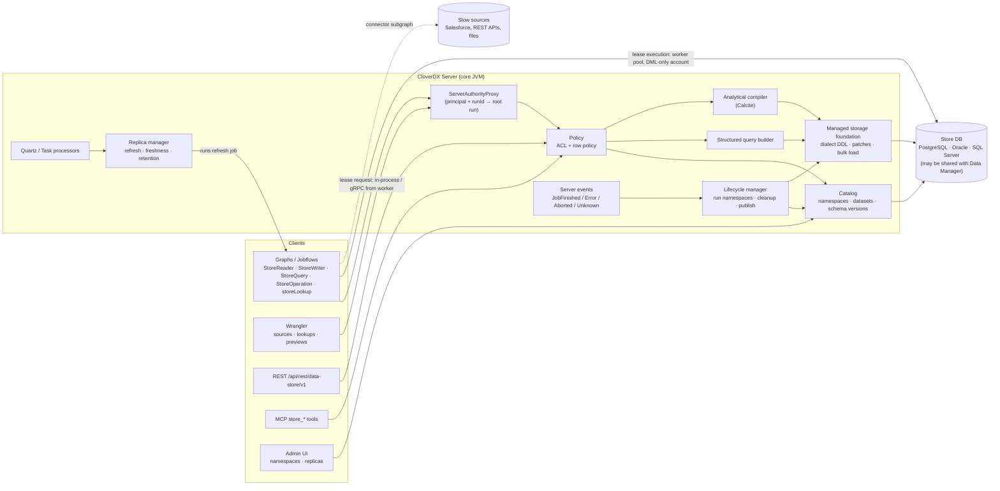

# 5. Architecture


## 5.1 Placement in the codebase

| Piece | Location (proposed) | Pattern followed |
|---|---|---|
| Catalog, namespaces, policy, lifecycle, replicas | `S/datastore/**` (Spring context `applicationContext-dataStore.xml`) | `S/datamanager/**` |
| Shared storage foundation | `S/managedstorage/**`, extracted from `S/datamanager/schema` | D1 |
| SQL compilation | `S/datastore/query/**` using Calcite (already on the classpath) | `PerformanceLogsManager` (existing Calcite use) |
| Public REST | `web/WEB-INF/rest/data-store/v1/data-store-openapi.yaml`, generated module `cloverdx.server.rest-datastore`, controllers `S/api/restdatastore/v1` | Public DM REST |
| MCP tools | `S/mcp/tool/{descriptor,catalog}/datastore`, new `ToolCategory` or reuse of `DATA_MANAGER`'s gate pattern | CLO-37003 |
| Engine contract | New `IAuthorityProxy` methods that return leases, plus DTOs and the lease executor in `E/datastore/*`. Lease requests from workers go through `ServerAuthorityProxyApi`. Proxied fallback for row-policy datasets and `lease.mode` | DM `IAuthorityProxy` methods, `worker.jndi.datasource` |
| Components | `cloveretl.component.commercial`: `StoreReader`, `StoreWriter`, `StoreQuery`, `StoreOperation` | DM readers and writers |
| Lookup | `cloveretl.lookup.commercial`: `storeLookup` | `ReferenceLookupTable` |
| Wrangler | `SourceReplicaProvider` in `E/wrangler` (Server implementation in `S/wrangler`), `STORE_READER` emitted by `WConnectorSource`, `WStoreSource` / `WStoreTarget`, lookup index and staging in the source and step conversion | `SourceCacheProvider`, `WDataSetSource` |
| CTL functions | `cloveretl.ctlfunction.commercial`: `storeExists`, `storeRowCount`, `storeAsOf`, `storeState` (D28) | Existing commercial CTL function libraries |
| Web UI | `cloverdx.frontend/cloverdx.webapps/src/server/data-store/` (admin: namespaces, replicas, freshness) | `src/server/data-sets` |
| Scheduling | `Task.TaskType.datastore_replica_refresh`, `datastore_maintenance` | `data_manager_maintenance` |

## 5.2 Component view



## 5.3 Data plane: how records travel

Today DM components send every record through `IAuthorityProxy`. For a worker, that means a gRPC hop to the core, which runs JDBC. This is fine for DM volumes. It would be the bottleneck for replica loads and large reads.

| Mode | Path | Security | Throughput |
|---|---|---|---|
| **Direct lease** | The core compiles the statement (ACL checked, row policy applied, physical names resolved) and hands the worker a **lease**. The worker executes the lease on a worker-local connection pool. | Store DB credentials sit in the worker JVM, where user Java code also runs (see the trust boundary below) | Native JDBC and bulk APIs |
| **Proxied** | Worker ⇄ gRPC (record blocks in CloverDX binary format) ⇄ core ⇄ JDBC | Credentials never leave the core | Bounded by the core |

**D4 (decided). Direct lease from the start. Proxied mode remains for what must not be leased.**

**The lease** is a short-lived, single-use object the core issues per component and statement. It holds:

- the compiled SQL and its bind values, with the row policy already in the statement
- the pinned physical tables (snapshot pinning, [§8.6](08-replicas.md#86-consumer-contract-and-snapshot-pinning))
- the operation kind (read, append, upsert, bulk load)
- the run id
- an expiry

The worker executes exactly that statement. It never builds SQL from logical names, and it never sees the catalog. A job on the core JVM uses the same lease, executed in process.

**Worker connections** follow the existing pattern for giving workers pooled DB connections (`worker.jndi.datasource[n].*`, with drivers in `worker.classpath`, by default `${clover.home}/worker-lib`). The store configures a worker datasource for its DB automatically, from its own settings. The store DB's JDBC driver must therefore be present in the worker classpath, and the server checks this at worker start.

**Two DB accounts:**

- The **owner** account is used only by the core. It runs DDL, catalog writes, swaps and maintenance.
- The **worker** account can only select, insert, update and delete on store data tables. It has no DDL rights and no rights on catalog tables. A worker therefore cannot drop tables, alter schemas or move a dataset's current-table pointer.

**Trust boundary.** In lease mode, ACL and row policy bind every platform path: components, Wrangler, REST and MCP. Arbitrary user code running in a worker (a Java transform, a custom component) could open the worker pool itself and read or change any table the worker account reaches. This is the same trust level as graph DB connections today, whose credentials are also in the worker. Three rules keep the hard boundaries where they matter:

1. **Datasets with a row policy are never leased.** The worker account has no grant on their tables, and they are always served proxied. Row policy therefore stays a hard boundary, even against user code.
2. **`datastore.lease.mode`** (`ALL` | `SYSTEM_JOBS` | `OFF`, default `ALL`) lets a deployment that needs ACL as a hard boundary restrict leases:
   - `SYSTEM_JOBS`: only replica refresh, staging and lookup-index builds are leased
   - `OFF`: everything is proxied
3. **The worker account's grants are managed by the core** on each table's creation, drop and policy change. They never include catalog, audit or DM tables.

The proof of concept still measures both modes on a 10M-row load, so the cost of `OFF` is known to administrators who choose it.

**Bulk load** uses the JDBC bulk APIs inside the lease executor:

- `CopyManager` for PostgreSQL
- `SQLServerBulkCopy` for SQL Server
- array binding or direct-path for Oracle

They are new to the codebase, and they run in the worker against the driver in `worker-lib`.

## 5.4 Where the catalog lives

The Data Manager keeps metadata in the **system DB** and data in the DM DB. The store has different needs:

- run namespaces create and drop tables at high rates
- publish and replica swaps must change the catalog pointer and the physical table together

**D5 (decided).** The store catalog lives in the **store DB**, next to the tables, so pointer swaps and DDL commit together where the dialect allows it:

- PostgreSQL: transactional DDL
- SQL Server: mostly transactional
- Oracle: DDL auto-commits, so swap uses a two-phase protocol with a recoverable `SWAPPING` state

Users, groups and run records stay in the system DB and are referenced by id. A repair task reconciles catalog rows with physical tables (orphans in either direction).

## 5.5 Type model

**D6 (decided). Scalars first, containers later.** Store columns carry CloverDX field types, not the DM's six types. From P1:

- string, integer, long, number, decimal(p,s), boolean
- date, which maps to a UTC timestamp (D26)
- byte and cbyte

**From P5: list, map and variant**, mapped to JSON:

- PostgreSQL: `jsonb`
- SQL Server: `nvarchar(max)` with an `ISJSON` check
- Oracle: `JSON` or `CLOB`

They come only after their mapping, null handling and SQL behaviour have been proven on all three databases. Until then, a writer whose metadata contains a container field is refused with a message naming the field. Graphs flatten or serialise containers first.

Logical metadata (field name, label, nullability, default, precision and scale, format hints) is stored as a **versioned schema** with a monotonic version number. Writers state the version they expect. A mismatch either fails or, for additive changes, upgrades with `LayoutDiff`-style DDL.

Type mapping is owned by the managed storage foundation, not by the engine `JdbcSpecific`. The DM already does this, and `PostgreSpecific` has no type mapping of its own.

**D26 (decided, Q4). Dates are stored as UTC in a plain timestamp.** A CloverDX `date` is an instant with millisecond precision. Its per-field `timeZone` metadata is used only for formatting.

| Database | Column type |
|---|---|
| PostgreSQL | `TIMESTAMP(3)` |
| SQL Server | `DATETIME2(3)` |
| Oracle | `TIMESTAMP(3)` |

- **Writing and reading** go through the storage foundation and always state UTC explicitly: `setTimestamp`/`getTimestamp` with a UTC `Calendar`, or `LocalDateTime` in UTC. The JVM's default time zone never takes part.
- **Why not copy the Data Manager.** The Data Manager writes `new Timestamp(epochMillis)` with no calendar (`SchemaHandler.toTimestamp`). With standard JDBC behaviour, its stored wall time therefore depends on the JVM's time zone, and could shift if that changes or if cluster nodes differ. The store does not inherit that.
- **The field's `timeZone` is kept** in the logical schema, so metadata served to graphs and Wrangler formats as it did at the source.
- **Dataset SQL** (Base §5) reads date literals and comparisons as UTC. The query documentation says so, with an example of filtering by a local calendar day.
- **DM foreign datasets** ([§4.3.1](04-placement.md#43-integration-points-with-the-data-manager)) are the one place the two conventions meet. Their scan mapping converts the DM's JVM-zone wall time to UTC, so a join between store and DM dates compares instants.

## 5.6 Security

**Principals.**

| Caller | Principal |
|---|---|
| REST or MCP | The authenticated user |
| Graph | The run's executing user. The server resolves it from `runId` and never trusts a value the job supplies. |
| Replica refresh | The replica's *refresh principal* ([§8.8](08-replicas.md#88-security)) |

**Global permissions.** New branch of `Operation`:

```
data_store_all
 ├─ data_store_admin        (manage namespaces, replicas, policies)
 ├─ data_store_create       (create datasets in namespaces where granted)
 └─ data_store_use          (read/write per ACL; required for components and REST)
```

**Object ACL.** Grants are on the namespace and are inherited by its datasets. A dataset can narrow them. Grants come from two sources (D24):

- **Explicit grants** to users or groups
- **Derived grants** from a linked sandbox or Wrangler workspace ([§6.1](06-namespaces.md#61-linking-a-namespace-to-a-sandbox-d24))

| Level | Allows |
|---|---|
| `READ` | Schema, structured read, SQL |
| `WRITE` | Insert, update, delete, truncate |
| `MANAGE` | Create, drop, alter, publish into |
| `ADMIN` | Grants and policies |

**Row policy.** As in Base §7. A policy is a predicate over logical fields and principal attributes:

- `user.name`
- `user.groups`
- user properties
- for a run, its sandbox and job file

The policy is compiled below every scan.

**Run namespaces bypass object ACL, not row policy.** Inside its own run namespace a job tree is `ADMIN`. Data read *from* shared namespaces keeps its row policy even after being copied into the run namespace, because the policy was applied when it was read. Publishing *out* requires `MANAGE` on the target namespace.

## 5.7 Configuration (proposed keys)

```properties
datastore.enabled=false
datastore.datasource.type=            # JDBC | JNDI | datamanager | empty (disabled)
datastore.datasource.jndiName=
datastore.jdbc.driverClassName=
datastore.jdbc.url=
datastore.jdbc.username=
datastore.jdbc.password=
datastore.jdbc.worker.username=       # DML-only account used by leases in workers (§5.3)
datastore.jdbc.worker.password=
datastore.lease.mode=ALL              # ALL | SYSTEM_JOBS | OFF (§5.3)
datastore.lease.ttl=PT10M
datastore.tablePrefix=DS_
datastore.run.retainOnFailure=PT24H   # how long a kept tree's TEMPORARY data stays (§7.7)
datastore.run.retainedDefault=P7D     # retention of RETAINED run datasets unless the dataset sets its own (§7.3)
datastore.run.drainWarnAfter=PT6H     # report a namespace still DRAINING (daemon child) after this
datastore.run.schema=                 # optional separate DB schema for run tables (§7.11)
datastore.scratch.maxTtl=P7D          # longest TTL a scratch namespace may ask for (§7.9)
datastore.run.defaultQuota.rows=
datastore.run.defaultQuota.bytes=
datastore.query.timeout=PT5M
datastore.query.maxRows=
datastore.replica.maxConcurrentRefreshes=4
datastore.staged.maxBytes=            # storage budget of the staged namespace (LRU)
datastore.staged.idleTtl=P14D
datastore.maintenance.interval=PT5M
wrangler.lookup.inMemoryMaxBytes=      # above this a lookup uses the lookup index (§9.5)
wrangler.staging.mainSourceMinBytes=   # main file sources at least this large are staged (§9.6)
```

## 5.8 Licensing

**D25 (decided, Q2). A module flag, plus optional limits.** Seat-based licensing, like the Data Manager's, does not fit machine use.

| Licence element | Meaning | Enforcement |
|---|---|---|
| `LicenseModules.dataStore` ("Data Store") | Gates the feature: components, REST, MCP, Wrangler integration, admin UI | Same pattern as `DataSetManager.requireDataManagerLicense()`. Without it, store calls fail with a licence message, and Wrangler behaves as if no replicas existed. |
| `maxDataStoreReplicas` (optional) | Number of replica instances in states other than `REQUESTED` | Approving or creating one more is refused. Existing replicas keep refreshing. |
| `maxDataStoreBytes` (optional) | Total stored size across all namespaces (shared, scratch, run, replica, staged), from catalog statistics | A warning at 90 %. Above 100 %, writes that grow storage are refused, except replica refreshes of existing replicas. Reads, drops and truncates always work. |

When a limit is absent, it does not apply. Packaging can therefore change in the licence file without code changes. The limits are a new kind of licence property, next to the seat counts in `LicenseMaxUserCounts` but not a user count, and are read by `LicenseBean`.

---

← [4. Placement relative to the Data Manager](04-placement.md) · [Index](README.md) · [6. Namespaces](06-namespaces.md) →
