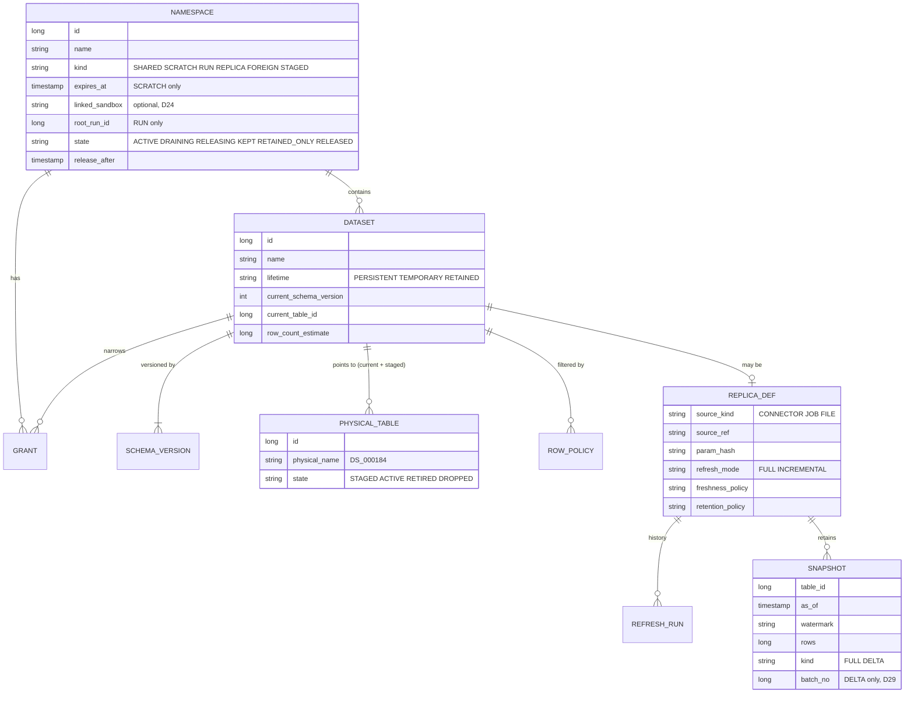

# 6. Namespaces

The Base spec leaves name scoping open (Base §11, "Catalog and lifecycle"). This spec makes the **namespace** the unit of isolation, ACL and lifecycle.

| Kind | Name | Created by | Lifetime | Visibility |
|---|---|---|---|---|
| **Shared** | `crm`, `finance`, … (admin-chosen) | Admin, or a user with `data_store_create` | Until dropped | ACL |
| **Run** | Addressed as `run`, stored as `run_<rootRunId>` | Automatically, on first use within a job tree | Tree lifetime ([§7](07-run-namespaces.md#7-run-scoped-namespaces)) | The tree's runs while it runs. Afterwards, kept data is read-only for users who may see the root run in the execution history, and for admins ([§7.3](07-run-namespaces.md#73-dataset-lifetimes-inside-a-run-namespace)). |
| **Scratch** | Chosen by the creator, e.g. `tmp_<rootRunId>` | A job (`StoreOperation CREATE_NAMESPACE`) or a user, with `data_store_create` | Its TTL, at most `datastore.scratch.maxTtl` | ACL set at creation; the creator is `ADMIN` |
| **Replica** | `replica` (system-owned), or a shared namespace chosen per replica | Replica manager | Replica retention ([§8.7](08-replicas.md#87-retention)) | ACL on the replica |
| **Foreign** | `dm` | System | Mirrors DM | DM ACL mapped to `READ` |
| **Staged** | `staged` (internal, not addressable by name) | Wrangler conversion | LRU and idle TTL ([§9.6](09-wrangler.md#96-staged-file-datasets-excel-and-csv-lookups)) | Re-checked against the original file or snapshot on every use ([§9.5](09-wrangler.md#95-lookups), [§9.6](09-wrangler.md#96-staged-file-datasets-excel-and-csv-lookups)) |

Addressing: `namespace.dataset` everywhere (components, REST, SQL). `run.x` always means the caller's own tree. An unqualified name is an error. There is no search path, so a temporary table never silently shadows a shared one.

## 6.1 Linking a namespace to a sandbox (D24)

**D24 (decided, Q3). Namespaces have their own ACL, plus an optional link.** An admin can link a shared or scratch namespace to **one** sandbox or Wrangler workspace. The link adds grants derived from that sandbox's permissions, so teams organised by sandbox don't administer permissions twice.

| Linked permission | Derived namespace grant |
|---|---|
| Sandbox `read` | `READ` |
| Sandbox `write` | `WRITE` + `MANAGE` |
| Sandbox `execute` | None. Running jobs does not imply data access. |
| Workspace `VIEWER` | `READ` |
| Workspace `EDITOR` | `WRITE` + `MANAGE` |
| Workspace admin | `WRITE` + `MANAGE` |

Rules for links:

- `ADMIN` on a namespace (grants and policies) is never derived. It comes only from an explicit grant or `data_store_admin`.
- **Derived grants are evaluated at check time, not copied.** A change to the sandbox's permissions applies to the namespace immediately. Removing the link removes the derived grants.
- The effective permission is the union of explicit and derived grants. Row policy applies on top of either, as always.
- **Names stay global.** A link does not make `ns.dataset` resolve differently per sandbox. For portability between dev, test and prod, jobs use parameters (`${CRM_NS}.customers`).
- **Deleting the sandbox drops the link, never the namespace.** Store data is not deleted as a side effect. The namespace is reported as unlinked.
- **Configuration export and import** (the server config JAXB model, as for DM data sets) carries namespace definitions, explicit grants and the link by sandbox code. Data is never exported.
- **Wrangler convenience.** A workspace's linked namespace is offered as the default target namespace in Wrangler. This only suggests a target; it does not change name resolution.

## 6.2 Catalog model

A dataset points to a **current physical table**. All atomic operations work by moving that pointer:

- publish
- full replica refresh
- schema migrations that need a rewrite

Readers resolve the pointer once per statement, so they always see one consistent version.

---

← [5. Architecture](05-architecture.md) · [Index](README.md) · [7. Run-scoped namespaces](07-run-namespaces.md) →
