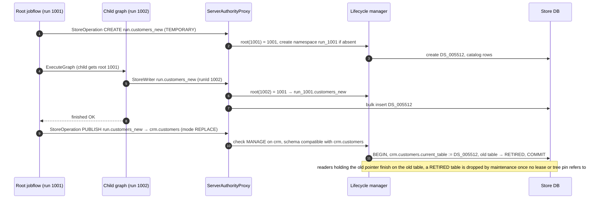
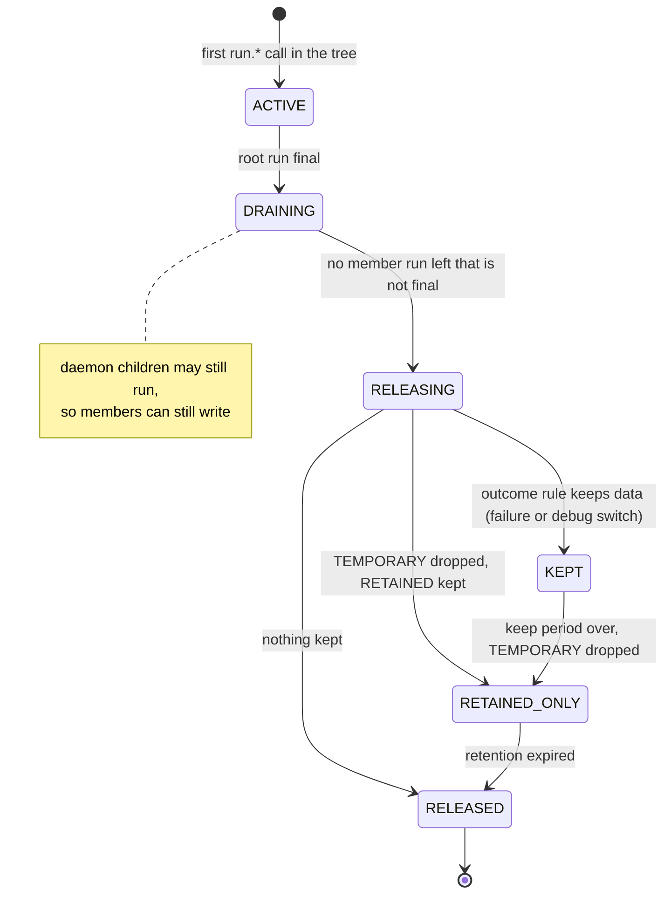

# 7. Run-scoped namespaces

## 7.1 Requirements

- R1. A top-level job and all its descendants (ExecuteGraph, ExecuteJobflow, subgraphs, Wrangler jobs) share one namespace, isolated from every other run.
- R2. Jobs in the tree can create, alter, write, read and drop datasets in it, and can also work with shared namespaces under normal ACL.
- R3. Temporary datasets disappear when the tree finishes, including after a crash.
- R4. Results built in the run can be made visible to others atomically.
- R5. It works when children run on other cluster nodes or in worker JVMs.
- R6. A run that never uses the store pays nothing.
- R7. After a failure, the data can be inspected long enough to debug it.

## 7.2 Membership and identity

**Rule.** The namespace key is the tree's root run id: `root(run) = run_record.root_run_id ?? run.id`.

A root job's own run record has `root_run_id = null`. Every child gets *parent's root ?? parent's id* when its execution command is prepared:

- `ServerAuthorityProxy.prepareExecutionCommand` and `prepareWranglerExecutionCommand`
- `MasterStartingStrategy` (partitioned cluster graphs)
- `WranglerJobStartingStrategy`

`ExecutionHelper` fills the `ROOT_RUN_ID` graph parameter by the same rule, so a job sees the same value the store uses.

Which start paths join which tree:

| Start path | Namespace | Notes |
|---|---|---|
| Schedule, event listener, REST, SOAP, HTTP API, Server Console, Designer "run on Server" | Its own tree, as root | |
| ExecuteGraph, ExecuteJobflow, ExecuteWranglerJob, WranglerJob component | The parent's tree | Daemon children included |
| Subgraph component | The parent's run | |
| Partitioned cluster graph (worker partitions on several nodes) | The master's tree | |
| Data service request (Data App, `RESTJOB`) | **None**: `run.*` is refused in the whole tree | [§7.10](#710-data-service-requests-q19) |
| A root without a run record (`persistentRunRecord = false`): a schedule or task with `saveRunRecord=false`, a Wrangler preview, a view-data run | **None**: `run.*` is refused in the whole tree (D30) | Such a run has a negative id from an in-memory sequence, which is not unique over time or across nodes, and the sweeper cannot see it. Children inherit the flag. The error names the `saveRunRecord` setting. Wrangler staging uses the `staged` namespace, never `run`. |
| A child without a run record whose root has one (the profiler's `executeGraphSync`) | The root's tree | It is a synchronous child, so a member with a run record always outlives it. |
| A job started *because of* another tree: a jobflow or file event listener, or an HTTP call made by a job | **Its own tree**. It is not a member. | Sharing data with it is covered in [§7.9](#79-sharing-with-jobs-outside-the-tree-q5). |

**Resolution in the core.** Every store call arrives through `ServerAuthorityProxy`:

- in process, it holds the calling run's runtime environment
- from a worker, the gRPC API carries `runId`, and the core finds the environment among its running jobs

The root is read from that environment, with no DB lookup per call. The caller never names its namespace, which guarantees isolation: a job cannot reach into another tree's namespace by guessing its id.

**Lazy creation (R6).** The namespace row is created on the first `run.*` reference, by a conditional insert on the unique root id. Concurrent first calls from parallel children are safe. A tree that never says `run.` costs nothing. A tree that only reads shared datasets gets the row too, to hold its pins ([§6.2](06-namespaces.md#62-catalog-model)), but no tables.

**D30 (proposed). The store keeps its own record of the tree.** The execution history cannot be relied on after the run:

- The archivator deletes run records older than its limit (30 days by default), one node at a time and with no regard for trees. A root's record can go while a daemon child still runs.
- Deleting a sandbox, or importing a server configuration, deletes that sandbox's run records.

So the namespace row carries a **tree record**, written at creation and completed at release:

- root run id, sandbox, job file and executing user
- start time, end time and outcome ([§7.7](#77-tree-outcome-and-keeping-data-for-debugging-q6))

Retention, access after the run ([§7.3](#73-dataset-lifetimes-inside-a-run-namespace)) and the *Data* tab ([§7.13](#713-visibility-in-the-execution-history)) read the tree record, never the run record. Only the question "is a member still running?" uses run records, because a running member always has one (D30 refuses `run.*` to roots without a record).

## 7.3 Dataset lifetimes inside a run namespace

| Lifetime | Behaviour at tree end | Use |
|---|---|---|
| `TEMPORARY` (default in `run`) | Dropped, subject to the tree outcome rule ([§7.7](#77-tree-outcome-and-keeping-data-for-debugging-q6)) | Staging, intermediate results, lookups |
| `RETAINED` | Kept, read-only, for a retention period (per dataset, default `datastore.run.retainedDefault`) | Run outputs worth inspecting, audit evidence |
| `PUBLISHED` (an action, not a state) | The physical table is moved into a shared dataset ([§7.4](#74-publish-build-in-isolation-swap-atomically)). Nothing is left in the run namespace. | Build-then-swap |

**After the run**, a retained or kept dataset is addressable read-only as `run_<rootRunId>.x` by:

- users who could see that root run in the execution history: read permission on the sandbox named in the tree record (D30), or `run_record_list_unlimited`. This is checked against the tree record, so it still works after the run record is purged.
- holders of `data_store_admin`

If the sandbox has been deleted, only `data_store_admin` holders can read the data.

An admin can also **publish a retained dataset after the run**, for example to promote the output of a run that failed only at its final step.

Writes to **shared** datasets from inside a run are ordinary writes. They are not undone if the tree fails. All-or-nothing behaviour comes from publish, not from distributed transactions.

## 7.4 Publish: build in isolation, swap atomically

Publish modes:

- `REPLACE`: pointer swap
- `APPEND`: `INSERT … SELECT` inside the DB
- `MERGE`: upsert by key, inside the DB

`REPLACE` is the only one that is O(1) and atomic on every dialect.

## 7.5 Namespace lifecycle

A run is final when its `Result.isStop()` is true: `FINISHED_OK`, `ERROR`, `ABORTED`, `TIMEOUT` or `UNKNOWN`.

## 7.6 Detecting that a tree has finished

The platform has no "tree finished" signal, and daemon children can outlive the root. The design combines an event trigger with a sweeper:

1. **Event trigger.** A `ServerEventListener` receives job end events (`JobFinished`, `JobError`, `JobAborted`, `JobUnknown`, timeout) and resolves the run's root.
   - If the run is the root, the namespace moves to `DRAINING`.
   - In either case, if the namespace is `DRAINING`, the listener checks for members still running: `id = R OR root_run_id = R`, with a status that is not final (`RunRecordFilter.setRootRunId`; `root_run_id` is indexed). If there are none, the namespace moves to `RELEASING`.
2. **Sweeper.** The `datastore_maintenance` task (the `TaskProcessorDataManager` pattern) re-evaluates `ACTIVE` and `DRAINING` namespaces whose root is final. This covers:
   - lost events
   - cluster failover
   - runs moved to `UNKNOWN` by `solveUnresolvedGraphs` after a crash
3. **Cluster safety.** State changes are conditional updates (`… SET state='RELEASING' WHERE id=? AND state='DRAINING'`). Only the node whose update wins drops the tables, so no cluster lock is needed.
4. **Orphans (D30).** A missing root run record alone never releases a namespace. The rule depends on the state:
   - `ACTIVE` or `DRAINING`: if the root's run record is gone, the sweeper treats the root as final and runs the member check of step 1. The namespace moves to `RELEASING` only when no member run is running **and** the lease registry (D32) shows no lease for the tree. The outcome is then recorded as `FAILED`, because it can no longer be computed.
   - `KEPT` or `RETAINED_ONLY`: the purge of run records has no effect. These states end by their own timers (`release_after`), using the tree record.
5. **A daemon child that never ends** keeps its namespace in `DRAINING`. Tables are never dropped under a running member. Instead:
   - after `datastore.run.drainWarnAfter`, the namespace is reported in the admin UI and the log
   - an admin can abort the daemon, or release the namespace by force; the daemon's next store call then fails with "run namespace released"

## 7.7 Tree outcome and keeping data for debugging (Q6)

**D21 (Q6). The tree counts as failed if *any* member run ended `ERROR`, `ABORTED`, `TIMEOUT` or `UNKNOWN`**, even when the root handled the failure and finished `FINISHED_OK`. A failed tree keeps its `TEMPORARY` data for `datastore.run.retainOnFailure` (state `KEPT`), so failures the root handled stay debuggable with their data. A tree with no failed member drops it at once.

The outcome is computed at `RELEASING` from the members' run records (the same `root_run_id` query as [§7.6](#76-detecting-that-a-tree-has-finished)), so no member needs to report anything.

Two switches adjust that rule:

- **Per dataset: `keepOnFailure`**, default `true`, set on `StoreOperation CREATE` and on `StoreWriter createIfMissing`. Setting it to `false` drops a large intermediate dataset even in a failed tree, when keeping it is not worth the space. A dataset that must survive even a successful run uses the `RETAINED` lifetime instead.
- **Per job: the job config property `datastore.run.keepNamespace`** (`NEVER | ON_FAILURE | ALWAYS`, default `ON_FAILURE`), set on the root job. It is read through the existing per-job configuration (`JobConfigDataSourceFactory`, which already serves the job log level, for example).
  - `NEVER` drops everything at tree end.
  - `ALWAYS` is the debugging switch: everything is kept for `datastore.run.retainOnFailure`, whatever the outcome.

## 7.8 Concurrency inside a tree

Parallel children often write the same dataset.

| Concern | Rule |
|---|---|
| Create | `CREATE IF NOT EXISTS` with a schema equality check. Two children creating the same dataset with the same schema both succeed. Different schemas fail. |
| Append | Concurrent appends allowed, in separate transactions |
| Replace or truncate | Done by the core, through the lease registry (D32, [§5.3](05-architecture.md#53-data-plane-how-records-travel)). The core marks the dataset as *changing*, which stops new leases, then waits for the write leases on it to finish, or fails per `lockTimeout`. A leased writer cannot take a catalog lock itself, because the worker account has no rights on the catalog. |
| Schema change | The same protocol, waiting for read leases too. It bumps the version. A lease request that states an older version is refused. A writer never holds a stale lease across the change, because the change waits for it. |
| Read-your-writes | A writer's commit (per batch or at component end, configurable like `DBOutputTable`'s commit) makes rows visible to siblings |

## 7.9 Sharing with jobs outside the tree (Q5)

Some orchestrations leave the ExecuteGraph tree. A jobflow can finish and trigger another job through an event listener, call a Data Service over HTTP, or start a job through REST. Those jobs are roots of their own trees ([§7.2](#72-membership-and-identity)). Three ways to let them see the data:

| Option | How | For | Against |
|---|---|---|---|
| **A. Strict tree** | Not possible. Use ExecuteGraph, or publish into a shared namespace. | Simplest. No new trust model. | Event-driven designs must publish into a long-lived shared namespace and clean up themselves |
| **B. Join token** | The root obtains a token bound to its namespace and user, and passes it as a job parameter. The started job presents it and is recorded as a member, so `DRAINING` also waits for it. | Real membership, cleanup covers the joined job | A bearer secret in job parameters, which the execution history displays. Needs signing, expiry and same-user rules. |
| **C. Scratch namespaces** | `StoreOperation CREATE_NAMESPACE tmp_${ROOT_RUN_ID} ttl=P1D grant=…` creates a **scratch** namespace ([§6](06-namespaces.md#6-namespaces)): shared by name, with a time-to-live and an ACL. Any job with access uses it by name. Maintenance drops it when the TTL expires. | Normal ACL, no secret. Also useful outside run trees. | No membership: cleanup is by TTL, not by tree end |

**D20 (Q5). Option C now, option B later.** Scratch namespaces ship with run namespaces:

- **Creation.** `CREATE_NAMESPACE` is idempotent for the same creator and name, so a retried jobflow does not fail. The TTL can be extended (`EXTEND_TTL`) and the namespace dropped early (`DROP_NAMESPACE`).
- **Contents.** Datasets in a scratch namespace are `PERSISTENT` within it. They live as long as the namespace does.

So that a join token (option B) can be added later without a migration, membership is modelled now as a `NAMESPACE_MEMBER` relation:

- **Today the relation is derived:** the members are the runs whose root is the namespace's root.
- **The `DRAINING` check reads it through one query.** A later explicit member row (a run that joined with a token) is then also waited for, with no change to the lifecycle.

## 7.10 Data service requests (Q19)

A Data App or Data Service request is a root of its own (`RESTJOB`), and such requests can arrive many times a second. If a data service uses `run.*`, every request creates and drops tables. That is DDL churn on the store DB and catalog bloat on PostgreSQL. Lazy creation ([§7.2](#72-membership-and-identity)) means a data service that does not use `run.*` costs nothing.

**D23 (Q19). `run.*` is refused in data service trees.** A tree whose root is a `RESTJOB` gets no run namespace, and that includes its children (the root is recognised the way `JobQueue.isChildOfDataService` does it). The error names the alternatives:

- a shared namespace, for data the service reads or maintains
- a scratch namespace with a short TTL, for data that must outlive one request

Ordinary quotas apply to both. This keeps the load a busy Data App puts on the store DB predictable.

## 7.11 Physical storage

Run tables use their own name prefix (`DSR_`) and, where configured, a separate DB schema. Maintenance and space accounting can then treat them apart from shared data.

| Dialect | `TEMPORARY` tables | Drop |
|---|---|---|
| PostgreSQL | `CREATE UNLOGGED TABLE`: no WAL, much faster loads. An unlogged table is emptied after a database crash. That is acceptable for temporary data: the runs writing it end as `UNKNOWN`, and a kept table after a DB crash is simply empty. A `RETAINED` table is logged (`ALTER TABLE … SET LOGGED` when it is retained). Heavy create and drop bloats `pg_class`, which autovacuum handles. Quotas limit the rate. | `DROP TABLE` |
| Oracle | Ordinary table. `NOLOGGING` with direct-path bulk loads where the DBA allows it. | `DROP TABLE … PURGE`. Without `PURGE`, dropped tables stay in the recycle bin and keep their space. |
| SQL Server | Ordinary table. `tempdb` and `#temp` tables cannot be used, because they are tied to one session, and the members of a tree use many connections. | `DROP TABLE` |

## 7.12 Quotas

Per run namespace: maximum datasets, rows and bytes (`datastore.run.defaultQuota.*`, overridable per sandbox and per job config). Byte usage comes from catalog statistics refreshed on commit. Rows are counted exactly at write time. Exceeding a quota fails the write with an error naming the quota. This is new: the job queue tracks only CPU and heap.

## 7.13 Visibility in the execution history

The execution detail of a root run gets a **Data** tab. The detail tabs are defined in `executions_right.xml` and owned by `ExecutionsController`; the tab embeds a web component, as the Job Inspector tab does. It shows:

- namespace state and the datasets in it
- each dataset's lifetime, rows, size and the member run that created it
- for kept and retained data, the date it will be dropped

Actions there: *release now*, *extend retention*, *publish* (admin). This view lets people debug with the data, not just the log.

## 7.14 Designer and local runs

The store follows the Data Manager precedent:

- For a Server project, `GuiAuthorityProxy` asks the Server for design-time information (metadata).
- In a local execution, data calls fail with "Using Data Sets is not possible in local executions" (`PrimitiveAuthorityProxy`).

**D7 (decided).** Store metadata is available at design time for Server projects. Store data is accessed only in runs on the Server.

**Run datasets have no design-time catalog entry**, because they exist only while a tree runs. A `StoreReader` of `run.x` therefore takes explicit metadata. The idiomatic pattern is one external `.fmt` shared by the writer that creates `run.x` and every reader. `StoreOperation CREATE` can take that same metadata. A future improvement could propagate the writer's metadata through the jobflow, but that is not proposed now.

**D22 (Q7). No embedded local store.** Graphs that use the store run on the Server. A local run fails with a clear message, as Data Manager graphs do today. That leaves no second SQL dialect to keep in step with PostgreSQL, Oracle and SQL Server.

---

← [6. Namespaces](06-namespaces.md) · [Index](README.md) · [8. Replicas (shadow datasets)](08-replicas.md) →
