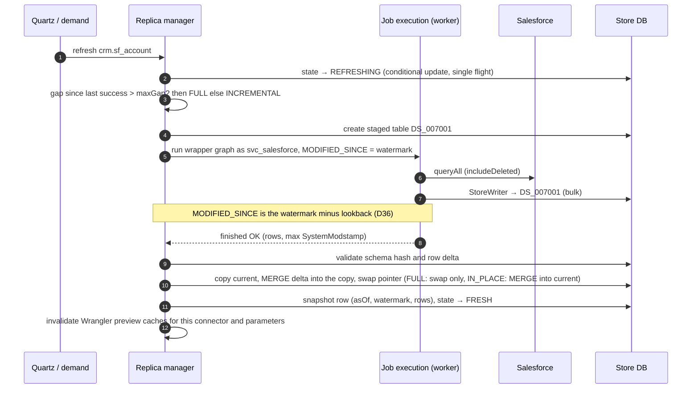
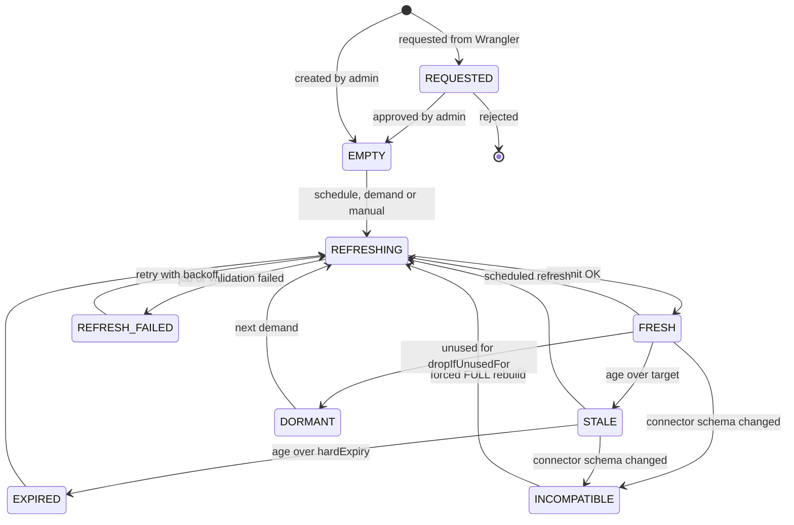

# 8. Replicas (shadow datasets)


## 8.1 Concept

A **replica** is a store dataset whose content is owned by a **source binding**, not by user writes. The replica manager keeps it within a freshness target by running a refresh job, and records *how fresh* it is. Consumers state *how fresh it must be*.

| Kind | Source reference | Typical example | Section |
|---|---|---|---|
| `CONNECTOR` | Library code, connector path and parameter values (the Wrangler connector: a `.sgrf` with no input and one output) | Salesforce Account object | [§8.2](#82-two-layers-connector-capability-and-replica-instance)–[§8.9](#89-replica-state) |
| `JOB` | Any graph or subgraph with one output port, plus parameters | A custom REST extraction | Same as `CONNECTOR`, with the capability given in the instance |
| `FILE` | URL plus parser settings and metadata. Freshness is a file **fingerprint**, not a clock. | Excel lookup table | [§9.6](09-wrangler.md#96-staged-file-datasets-excel-and-csv-lookups) (*staged datasets*) |
| `QUERY` | Dataset SQL over other store datasets (materialised view) | Dashboard aggregates | Later phase (Base §11) |

## 8.2 Two layers: connector capability and replica instance

Only the connector's author knows which parameter carries a "modified since" value, which output field is the change watermark, how deletes show up, and which parameters do not affect content. The operator decides how often to refresh, how long to keep data, and who may read it. The spec separates the two.

**Capability**: declared by the connector author in the library's `library.json`. It is an optional `replica` object beside the existing connector entry in `publicInterface.dataConnectors.sources[]`, so it is versioned with the library:

```json
{
  "path": "graph/subgraph/SalesforceObject.sgrf",
  "description": "Reads one Salesforce object",
  "replica": {
    "replicable": true,
    "key": ["Id"],
    "incremental": {
      "watermarkField": "SystemModstamp",
      "watermarkParameter": "MODIFIED_SINCE",
      "watermarkComparison": "GREATER_OR_EQUAL",
      "lookback": "PT15M",
      "deletes": { "mode": "TOMBSTONE", "flagField": "IsDeleted", "maxGap": "P14D" }
    },
    "parameters": {
      "OBJECT": "identity",
      "FIELDS": "identity",
      "WHERE": "identity",
      "BATCH_SIZE": "volatile",
      "TIMEOUT": "volatile"
    },
    "defaults": { "freshnessTarget": "PT24H", "hardExpiry": "P7D", "schedule": "0 0 1 * * ?" }
  }
}
```

**Instance**: a row in the store catalog. It names the connector and the concrete parameter values, and holds the operational policy:

```yaml
replica: crm.sf_account               # dataset name (namespace.dataset)
source: { kind: CONNECTOR, library: salesforce, connector: graph/subgraph/SalesforceObject.sgrf,
          parameters: { OBJECT: Account, FIELDS: "Id,Name,Industry,OwnerId,SystemModstamp,IsDeleted" } }
refresh:
  mode: INCREMENTAL                   # FULL | INCREMENTAL (INCREMENTAL needs the capability)
  apply: COPY_AND_SWAP                # COPY_AND_SWAP | IN_PLACE, INCREMENTAL only (D35)
  schedule: "0 0 1 * * ?"             # from capability defaults unless overridden
  fullReconcile: "0 0 2 * * SUN"      # required when mode is INCREMENTAL (D36)
  window: { notBefore: "22:00", notAfter: "05:00" }
  principal: svc_salesforce
  minOnDemandInterval: PT1H           # rate limit for "Refresh now"
freshness: { target: PT24H, hardExpiry: P7D, onStale: USE_WITH_WARNING }
retention: { snapshots: 3, maxSnapshotAge: P30D, dropIfUnusedFor: P90D }
validation: { maxShrink: 20% }        # refuse a FULL swap that loses more than 20 % of rows
substitution: OPT_IN                  # OPT_IN | ALL_MATCHING: which Wrangler sources read it (D37)
```

The two layers combine as follows:

- **A `JOB` source has no `library.json`.** Its instance carries the capability fields itself.
- **Instances are created in the admin UI or through the REST or MCP API**, by holders of `data_store_admin`. Each instance inherits the capability defaults.
- **Wrangler users request, admins approve (D16).** Any Wrangler user who may execute a replicable connector can choose "Keep a replica of this source". That creates an instance in state `REQUESTED`, with the source's parameters and the capability defaults, and notifies data store admins. An admin approves it, possibly adjusting the schedule, window, retention or readers, which moves it to `EMPTY` and schedules the first load. An admin can also reject it with a reason. Until approval, Wrangler keeps reading the source live and shows "replica requested". Requests are deduplicated by replica identity: a second request for the same connector and parameters joins the first.
- **A library upgrade re-validates the instances of its connectors.** `LibraryManager` already notifies Wrangler of library changes. The replica manager listens on the same hook.

**D9.** The capability is declared in `library.json`. Instances live in the store catalog. A connector without a `replica` block can still be replicated, but only with `FULL` refresh and with every parameter treated as identity.

## 8.3 Identity and parameters

Replica identity is: library code + connector path + the normalised **identity** parameters, sorted by name.

- `volatile` parameters are dropped from the identity. Undeclared parameters count as identity.
- `NUM_OF_PREVIEW_RECORDS` is never part of the identity. `LibraryManager` already excludes it from connector parameters.
- **Values must be concrete.** Wrangler applies runtime parameter values to the source before conversion (`WranglerManager.loadWModelAttributes`, called from `translateJobForExecution`). A value can still contain a `${…}` reference that is resolved only when the generated graph runs. The resolver expands such references against the sandbox's parameters before hashing, the same values the generated graph would see. If a reference cannot be resolved at that point (for example it depends on a value known only at graph runtime), the source does not match any replica: it is read live and the run logs a warning naming the parameter (D15).
- **The library version is not part of the identity.** On every use, the connector's current output metadata is compared with the replica's `connectorSchemaHash`. A mismatch marks the replica `INCOMPATIBLE`. It is not served, and the next refresh is a FULL rebuild.
- **Pushdown parameters, which answer a narrower request from a broader replica, are deferred** (former Q8). They need a parameter-to-predicate mapping that only the connector author can define, and identity-only matching is correct, if wasteful.
- **Connectors that use the caller's own credentials are not replicable** in the first release (former Q13, see [§8.8](#88-security)).

## 8.4 Refresh

The replica manager generates a **wrapper graph**: `SUBGRAPH(connector, parameters [+ watermark]) → StoreWriter(staged table)`. The SUBGRAPH is wired the same way `WConnectorSource.addReaderComponent()` wires it for Wrangler, so the connector runs exactly as it does in a Wrangler job. The refresh is an ordinary server job:

- execution history, logs, worker placement and the job queue all apply
- its run id is recorded as `refreshRunId`

**FULL (snapshot and swap)**

1. Create a staged physical table.
2. Run the wrapper graph into it. Assign `__src_row` (arrival ordinal) per row.
3. Validate the load:
   - The connector schema hash must match.
   - The row-count change must be within `maxShrink`. This protects against a connector that "succeeds" with an empty result because of an expired credential or a wrong filter.
4. Swap the dataset's current-table pointer in one catalog transaction (as in [§7.4](07-run-namespaces.md#74-publish-build-in-isolation-swap-atomically)).
5. Mark the old table `RETIRED` and keep it as a snapshot under the retention rules.

A failed run or a failed validation leaves the previous snapshot current and sets `REFRESH_FAILED`.

**INCREMENTAL (watermark merge)**

1. Read the stored watermark: the maximum `watermarkField` over all rows loaded so far.
2. Run the wrapper graph with `watermarkParameter` set to **the watermark minus `lookback`**, into a staged delta table (D36).
3. Apply the delta by key, in the way `apply` says (D35):
   - `COPY_AND_SWAP` (default): copy the current table inside the database (`CREATE TABLE … AS SELECT`, with its indexes), `MERGE` the delta into the copy, then swap the pointer as a FULL refresh does. The previous table becomes a `RETIRED` snapshot.
   - `IN_PLACE`: `MERGE` the delta into the current table, in one transaction.

   In both:
   - Rows flagged as deleted (`deletes.mode = TOMBSTONE`) become deletes.
   - New keys get the next `__src_row` values. Updated keys keep theirs.
4. Advance the watermark only when the swap or the merge commits.
5. Keep the staged delta table as **delta batch N** (a numbered snapshot of kind `DELTA`) instead of dropping it, under the snapshot retention rules ([§8.7](#87-retention)). This prepares the change feed (D29). Rows re-read only because of `lookback`, and identical to the stored row, are left out of the batch, so the change feed does not report them twice.

**D35 (proposed). An incremental refresh is applied to a copy and swapped in, unless the instance chooses `IN_PLACE`.** Merging into the current table would change it under running readers, so the guarantees of [§8.6](#86-consumer-contract-and-snapshot-pinning) and [§8.7](#87-retention) would hold for FULL replicas only.

| | `COPY_AND_SWAP` | `IN_PLACE` |
|---|---|---|
| A pinned run reads one unchanging snapshot | Yes | No. Each statement is consistent on PostgreSQL and Oracle, and on SQL Server only with read-committed snapshot isolation. A run can see different data in two statements. |
| Roll back to the previous snapshot; diff two snapshots | Yes | No. The admin UI says so. |
| Tracking's `snapshotId` reproduces what the run saw | Yes | No. It identifies the batch the run started on. |
| Cost per refresh | One copy of the table inside the database, plus the merge. No extra source calls. | The merge only |
| Storage | One extra table per retained snapshot | None extra |

`IN_PLACE` is for objects so large that a nightly copy is not acceptable. The threshold at which an admin should choose it is to be measured in P3 (Q21).

**D36 (proposed). Lookback, and a mandatory reconcile.** A timestamp cursor alone loses rows:

- **Late commits.** A row whose transaction commits after a refresh has read past its timestamp is never seen by a strict "modified after the watermark" query. So each refresh re-reads from the watermark minus the capability's `lookback`. The merge by key makes the overlap harmless. `watermarkComparison` states whether the connector's parameter means "after" or "at or after".
- **Rows that leave the filter.** With an identity parameter that filters rows (`WHERE`), a row changed so that it no longer matches is not returned again, and would stay in the replica.
- **Changes that do not move the watermark**, such as a Salesforce formula field whose inputs changed on another object.

The last two are repaired only by a FULL refresh. An instance with `mode: INCREMENTAL` must therefore have a `fullReconcile` schedule; creating one without it is refused. A capability without `lookback` gets `PT0S` and a warning in the admin UI.

**Change feed (D29, decided for Q12).** Incremental replicas keep no SCD2 history and offer no "as of T" reads. What they do keep, from P3 on, is the delta batches, which hold the changed rows and the tombstones of each refresh. In P5 a reader can ask for **changes since batch N**:

- `StoreReader` gains `changesSince` (the last batch the consumer processed). It returns the rows of all later batches with an operation column (`UPSERT`, `DELETE`), plus the new last batch number for the consumer to store.
- REST adds `/replicas/{id}/changes?since=N`.
- Downstream jobs, for example a load into a warehouse, then process only what changed instead of the whole replica.
- **If batch N+1 has already been dropped by retention**, the call fails with an error telling the consumer to take a full read. Changes are never silently skipped.
- A FULL refresh (a `fullReconcile`, or a switch after `maxGap`) cannot be expressed as a delta. It starts a new batch sequence, and consumers that pass an older batch number get the same full-read error.

Batches cost almost nothing to keep, because the staged delta table already exists. Keeping them from P3 means the P5 feature needs no migration.

**Deletes.** The Salesforce components already support this: `SalesforceReader` and `SalesforceBulkReader` both have `includeDeleted`, which switches to `queryAll` and returns deleted records with `IsDeleted = true`.

- **Gap limit.** Salesforce returns deleted records only for a limited time (the recycle bin retention; the exact period needs checking). `maxGap` captures that limit: if the last successful incremental refresh is older than `maxGap`, the manager automatically runs a FULL refresh instead.
- **Hard deletes.** Records removed from the recycle bin are never returned. `fullReconcile` runs a periodic FULL refresh to catch them.

**Operational rules**

| Rule | Mechanism |
|---|---|
| Single flight | At most one refresh per replica, enforced by a conditional update of its state. A demand that arrives during a refresh joins it. |
| Source protection | `window` (allowed hours) and `datastore.replica.maxConcurrentRefreshes` |
| On-demand refresh | "Refresh now" in Wrangler, the admin UI, REST or MCP. Allowed to holders of `READ` on the replica, limited by `minOnDemandInterval`. A request inside the interval joins the last refresh, or is refused with the time of the next allowed one. |
| First load | The replica is `EMPTY` until the first FULL refresh commits. Consumers in `PREFER` mode read live in the meantime ([§9.3](09-wrangler.md#93-behaviour-per-usage)). |
| Retries | `REFRESH_FAILED` retries with exponential backoff, capped by the next scheduled run |



## 8.5 Freshness metadata

Stored per snapshot. Exposed through REST, MCP and the admin UI, in the Wrangler source badge, and in job tracking.

| Field | Meaning |
|---|---|
| `snapshotId` | Physical version that a consumer pins ([§8.6](#86-consumer-contract-and-snapshot-pinning)) |
| `asOf` | The time at which the replica was last known to match the source: the **start time of the last successful refresh**, for FULL and INCREMENTAL alike (D36). It is not the watermark. An object that nobody changed for a week has a week-old watermark and is still current, so measuring staleness from the watermark would expire it. |
| `loadedAt` | When the load committed |
| `refreshRunId` | Run of the refresh job, linking to its execution history and log |
| `rows`, `bytes` | Size |
| `watermark` | Incremental cursor: the highest `watermarkField` loaded. Used only to build the next refresh, never to judge freshness. |
| `batchNo` | Number of the delta batch for an incremental refresh (D29) |
| `connectorSchemaHash`, `libraryVersion` | Detect drift after a library upgrade |
| `state` | `REQUESTED`, `EMPTY`, `FRESH`, `STALE`, `EXPIRED`, `REFRESHING`, `REFRESH_FAILED`, `INCOMPATIBLE`, `DORMANT` |
| `lastAccessAt`, `accessCount` | Feeds `dropIfUnusedFor` and usage reporting |

## 8.6 Consumer contract and snapshot pinning

Each consumer (StoreReader, Wrangler source, REST read, SQL) may state `maxStaleness` and `onStale`. If it does not, the replica's defaults apply.

| `onStale` | Behaviour when `now − asOf > maxStaleness` |
|---|---|
| `FAIL` | Error naming the replica, `asOf` and the policy |
| `USE_WITH_WARNING` | Read the current snapshot and log a warning with `asOf` (job log, Wrangler badge) |
| `REFRESH_AND_WAIT` | Trigger or join a refresh, wait up to `waitTimeout`, then fall back to `USE_WITH_WARNING` |
| `LIVE` | Bypass the replica and run the source directly. Wrangler only, never inside SQL. |

`hardExpiry` overrides `USE_WITH_WARNING`: an expired replica is never served, whether silently or with a warning.

**Pinning.** A consumer resolves the replica to a `snapshotId` once, at the scope given in [§6.2](06-namespaces.md#62-catalog-model) (D32):

- a job: once per **tree**, at the first resolution by any member (for a Wrangler job, at conversion). The pin is stored with the tree's namespace record.
- a REST or MCP read: once per request, carried across pages by a snapshot token
- a SQL statement outside a tree: when it is compiled
- a tree whose root has no run record (D30) has no namespace record to hold a pin. Each of its statements resolves the pointer on its own.

The whole tree then reads that snapshot, even if a refresh swaps the pointer meanwhile. The run's tracking records the snapshot, which makes a run reproducible ("which data did this job see?"). Retention never drops a snapshot that a tree has pinned or a lease is reading. Pins are released when the tree's namespace is released.

This holds for FULL replicas and for INCREMENTAL replicas applied with `COPY_AND_SWAP`. An `IN_PLACE` replica has one table that every refresh changes, so a pin there fixes only which table is read, not its content (D35).

## 8.7 Retention

Four independent rules, all enforced by `datastore_maintenance`:

1. **Snapshots.** Keep the last *N* snapshots and none older than *T* (pinned ones excepted). This supports rollback ("re-point to the previous snapshot") and diffs between refreshes. Delta batches (D29) are not counted against *N*. They are kept up to age *T*, so the change feed reaches back as far as the snapshots do. An `IN_PLACE` incremental replica (D35) has snapshots only from its FULL refreshes, so rollback returns it to the last reconcile.
2. **Rows.** Delete rows older than a field-based age, like DM `retention_days`.
3. **Unused replicas.** After `dropIfUnusedFor` without access, drop the data (state `DORMANT`) and keep the definition. The next use triggers a refresh.
4. **Compliance purge.** Remove a key, such as a person id, from the current table, all retained snapshots and all delta batches, and record it in the store audit.

## 8.8 Security

Who may read a replica follows from who could already get the same data live:

- **Default `READ` grant = the connector's execute groups.** Library connectors already carry execute and read groups (`S/library/DataConnector`). A connector that runs on the library's own credentials, such as a Salesforce integration user, already shows everyone who may execute it the same rows the replica holds. Defaulting the replica ACL to those groups exposes nothing new.
- **Wider grants are explicit.** The admin UI warns that replica readers bypass the source system's own visibility rules, such as Salesforce sharing rules.
- **Row policy narrows** where needed, for example `OwnerId IN user.attributes.sfUserIds`.
- **Connectors that use the caller's own credentials** (a per-user OAuth token, for example) make the source output user-specific. They are **not replicable** in the first release. Per-principal replicas (one private copy per user) are a possible later extension.
- **Refresh principal.** The replica runs as a named user, typically a service account, with execute permission on the connector and `MANAGE` on the replica. Credentials come from the library's parameters or secrets, as for any job.

## 8.9 Replica state



In `REFRESH_FAILED` the previous snapshot is still served. A failed refresh makes the replica staler. It does not make it unavailable.

---

← [7. Run-scoped namespaces](07-run-namespaces.md) · [Index](README.md) · [9. Wrangler integration](09-wrangler.md) →
