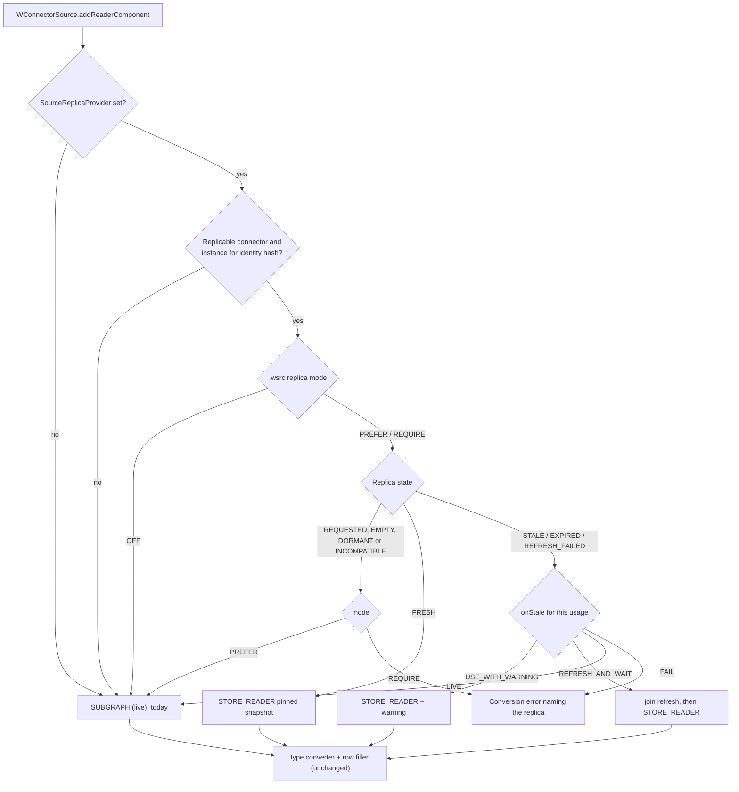
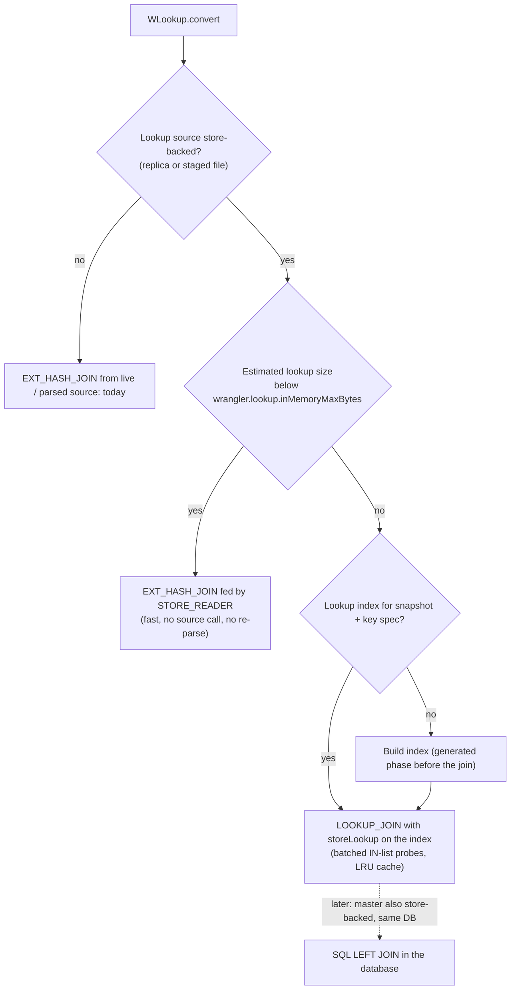

# 9. Wrangler integration


## 9.1 What the code does today

The facts below decide the design:

- **Every Wrangler conversion runs on the Server**, in `WranglerManager`. This covers:
  - previews (`preparePreviewOptions`)
  - full runs (`translateJobForExecution`, called after the job queue, with WranglerJob component parameters already applied by `loadWModelAttributes`)
  - the WranglerJob component path (`translateJobToSubgraph`)

  Wrangler conversion itself is engine code (`JobModelConverter`), but it always receives its context from the Server.
- **Server services are passed into the conversion through `ConversionContext`.** The preview cache is the existing example: a `SourceCacheProvider` that may be null, and full runs pass null ("Never cache sources").
- **A connector source compiles to a fixed chain:** `SUBGRAPH` → type converter `REFORMAT` → row-number filler. The converter (`SubgraphSourceTypeConverter.txt`) only copies fields by name (`$out.0.* = $in.0.*`) and sets an empty `w__errors`.
- **A lookup step compiles to `EXT_HASH_JOIN`** with `joinType=leftOuter` and the step's `ignoreCase`. Two key transforms (`getLookupKeysTransform`) produce string key copies on the master and lookup sides. `slaveDuplicates` keeps its default of `false`, so **the first lookup record per key, in arrival order, wins**. The lookup side is read completely into memory, and previews read it with no record limit (CLO-25965).

## 9.2 Hook point: `SourceReplicaProvider`

A new engine interface in `E/wrangler`, a sibling of `SourceCacheProvider`. It is carried in `ConversionContext` and implemented on the Server. Signatures are illustrative:

```java
public interface SourceReplicaProvider {
    /** A pinned replica snapshot to read instead of the source, or null to read the source as today. */
    ReplicaBinding resolve(WSource source, ReplicaUsage usage);
}
// ReplicaBinding: datasetName, snapshotId, asOf, state, warning (nullable)
// ReplicaUsage:   SOURCE_PREVIEW, STEP_PREVIEW, LOOKUP, FULL_RUN, WRANGLER_JOB_COMPONENT
```

- The Server sets it in **every** conversion: previews, full runs and the WranglerJob component. When it is null, conversion behaves exactly as today.
- `WConnectorSource.addReaderComponent()` emits a `STORE_READER` with dataset, snapshot and record limit when a binding is returned, and a `SUBGRAPH` otherwise. **Everything after the reader is unchanged**, so the downstream graph is identical by construction.
- The resolver runs with the job's user and checks `READ` on the replica. A user without access gets the live source, not an error, which is the same experience as before replicas existed.
- Job tracking (`createInitialTracking`) shows the source as "replica · as of …" and records the snapshot id.
- A `DORMANT` replica (data dropped after long disuse) behaves as `EMPTY` for this conversion, and the demand triggers its refresh.

**D10.** Replica resolution happens in the Server-side conversion through `SourceReplicaProvider`, once per conversion, and pins a snapshot. Graphs never decide at runtime between live and replica.

**D11.** A replica stores the connector's **native output** (its SubgraphOutput metadata) plus `__src_row`. Wrangler's converter and row filler stay in the graph. The same replica therefore serves Wrangler, StoreReader, REST and SQL without a Wrangler-specific copy.



## 9.3 Behaviour per usage

The `.wsrc` gains an optional `replica` element: `mode` (`OFF | PREFER | REQUIRE`, default `PREFER`), `maxStaleness` and `onStale`. A file without it behaves as `PREFER` with the replica's defaults. That is exactly today's behaviour wherever no replica exists.

| Usage | Default `onStale` | Reason |
|---|---|---|
| Source preview, step preview, lookup in a preview | `USE_WITH_WARNING` (never wait, never go live) | Waiting or going live is the slowness replicas remove. The badge offers "Refresh now". |
| Full run started from the Wrangler UI | Replica default (`USE_WITH_WARNING` unless set) | The user is watching and sees the warning |
| Unattended run (schedule, ExecuteWranglerJob, WranglerJob component) | `USE_WITH_WARNING` unless the replica or the `.wsrc` says otherwise (D17) | It never blocks or spends API quota during the day. A job that needs fresh data sets `REFRESH_AND_WAIT` or `FAIL` explicitly, and the warning with `asOf` is in its log and tracking. |
| `REQUIRE` with an `EMPTY` replica | Error | For sources whose live API must not be called during the day |

## 9.4 Previews and browsing

Two steps, each useful on its own, and one thing deliberately left out:

- **Step A: replica-fed previews.** No API change. The existing preview graph reads the replica through `STORE_READER` with `LIMIT`, so a 1,000-row preview of a Salesforce source no longer calls Salesforce.
  - A replica-backed source bypasses `WorkspaceCacheProvider`: the replica is the cache, so no cache file is written.
  - Creating or refreshing a replica invalidates existing cache files for that connector and parameters, using the same mechanism as `notifyLibraryChange` / `notifyDataSetChange`.
- **Step B: graph-free source browsing.** The connector chain only copies fields and adds a row number, so the Server can serve a *source* view straight from the store:
  - an exact count
  - `offset`, `limit`, `sort` and `filter` (Base §4 structured read)
  - the row number taken from `__src_row`

  This is a new endpoint in the internal Wrangler API (for example `/sources/{id}/browse`). The source tab then pages through millions of rows on the server instead of loading 1,000–100,000 rows into the browser, and `WranglerDataset.MAX_PREVIEW_CELLS` applies per page.
- **No SQL pushdown of recipe steps** (D27, Q10). Step previews always run the recipe graph. SQL serves source browsing (step B), lookups ([§9.5](#95-lookups)) and Data Store queries only. About 60 step types exist; many track per-cell errors (`w__errors`), and formula and filter steps contain arbitrary CTL. Translating them would create a second implementation of Wrangler semantics, which would have to be kept identical forever. Replica-fed previews (step A) already remove the slow part, which is calling the source.

**D14.** Steps A and B ship with the first Wrangler integration.

## 9.5 Lookups

**What must be preserved:**

- left outer join
- the first lookup record per key wins, in arrival order
- keys are compared as the strings produced by the step's key transforms
- `ignoreCase` as `EXT_HASH_JOIN` implements it

**Lookup index.** For a lookup step whose source is store-backed (a replica, or a staged file per [§9.6](#96-staged-file-datasets-excel-and-csv-lookups)), the conversion uses a derived **lookup index** dataset instead of loading the source into memory. The index is identified by (source snapshot or file fingerprint, key specification, `ignoreCase`):

- `__key`: computed **in the engine**, by the same CTL key transform and the same case normalisation that `EXT_HASH_JOIN` applies. The database only compares opaque strings, so string conversion and case folding cannot drift from CTL semantics.
- The payload columns the step adds (`addColumns`).
- **First row per `__key` by `__src_row`.** This reproduces `slaveDuplicates=false` exactly.
- A unique index on `__key`.

Building the index is a short generated graph (store read → key transform → dedupe → StoreWriter). It runs once per snapshot and key specification, and is reused by every later preview and run until the snapshot changes. The index lives in the internal `staged` namespace, and its lifetime follows the snapshot or file fingerprint it was built from.

**Execution choice per lookup step, at conversion:**



- **Small lookups** stay in memory. The change is only that the data no longer comes from a slow or memory-hungry reader.
- **Large lookups** use `storeLookup`, a `LookupTable` over the index. It probes the index in batches of keys per block of master records, and keeps hits in an LRU cache (the `DBLookupTable.maxCached` idea). Memory is bounded and round-trips are amortised.
- **SQL join pushdown** follows once the SQL compiler is proven (Base §5–[§6](06-namespaces.md#6-namespaces)). It applies only when the master source is store-backed in the same database.

**D13.** Lookup indexes, with keys computed in the engine, plus the size threshold. A parity suite gates each path: the same recipe runs through today's `EXT_HASH_JOIN` path and the new path, and the outputs must be identical. The suite covers duplicate keys, null keys, case variants, numeric keys converted to strings, and an empty lookup.

## 9.6 Staged file datasets (Excel and CSV lookups)

A `FILE` replica parses a file once and keeps the parsed rows in the store. Its freshness is a **fingerprint**:

- URL
- size
- last-modified time or ETag
- parser settings hash (sheet, ranges, CSV options)
- metadata hash

The fingerprint is checked on every use, so a stale copy is never served.

| Aspect | Rule |
|---|---|
| Scope (D18) | Every lookup source, and main sources whose file is at least `wrangler.staging.mainSourceMinBytes` (checked with the fingerprint). Small main sources keep today's preview cache. |
| Creation | When the fingerprint has no staged dataset, the conversion adds a staging phase: the existing reader (`SPREADSHEET_READER` / `FLAT_FILE_READER`) → StoreWriter into a staged table, published at phase end. This mirrors today's cache writer (`SIMPLE_COPY` + `CLOVER_WRITER` + `MOVE_FILES`). |
| Main sources | Staged only in **full runs**, never in previews. A preview has a record limit, and staging must read the whole file, which would make the first preview of a big file slow. The full run stages in a parallel branch (`SIMPLE_COPY` → StoreWriter) while the recipe processes the same records, so the first run costs little extra. The staged copy is published only if the whole file was read. Later previews and runs read it while the fingerprint matches. `__src_row` keeps the file order, so Wrangler row numbers are unchanged. |
| Reuse | Later previews and runs read the staged table and skip POI entirely. POI's memory cost is paid once per file version, not once per preview. |
| Location | System namespace `staged`. Not addressable by name, identified by fingerprint hash. |
| Security | The fingerprint check reads the file's attributes as the caller, through the caller's authority proxy. A caller without read permission on the file fails as today, so one staged copy can be shared between users safely. |
| Retention | LRU within `datastore.staged.maxBytes`, plus an idle TTL. Dropping a staged copy is always safe, because the next use stages it again. |

## 9.7 Wrangler targets

A store dataset becomes a Wrangler target (`WStoreTarget` → StoreWriter), like `WReferenceDataSetTarget`. Inside a run namespace, a Wrangler job can write `run.x` and a jobflow can publish it ([§7.4](07-run-namespaces.md#74-publish-build-in-isolation-swap-atomically)).

## 9.8 Relation to the existing preview cache

`WorkspaceCacheProvider` stays for sources that are neither replica-backed nor staged, such as a main CSV source in a preview. Replica-backed and staged sources bypass it. Replacing the file cache entirely by `staged` datasets is possible later, but is not proposed now.

---

← [8. Replicas (shadow datasets)](08-replicas.md) · [Index](README.md) · [10. Components and APIs: delta to Base §4–§8](10-components-and-apis.md) →
