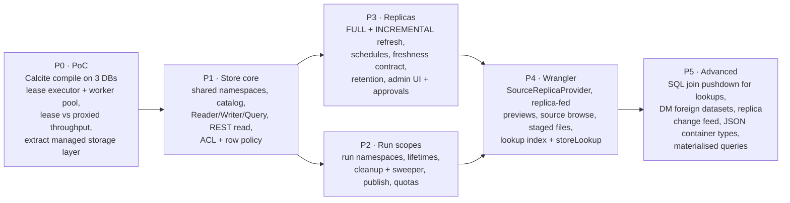

# 11. Phasing

Exit criteria per phase:

- **P0**:
  - Base §10 acceptance checks pass.
  - A lease loads at least X rows per second from a worker with the bulk API, and proxied mode is measured for comparison (X to be set).
  - The worker account cannot run DDL, cannot touch catalog tables, and has no grant on a table with row policy.
  - The store's worker pool cannot be opened from a graph DB connection by JNDI name (D31).
  - The DM test suite passes on the extracted storage layer.
- **P1**:
  - Base §10 join and aggregate checks pass from REST and from a graph, with row policy applied below each scan.
  - Without the `dataStore` licence module, every store entry point refuses with a licence message.
  - A namespace linked to a sandbox follows a change of that sandbox's permissions at once.
  - A date written on a node in one JVM time zone reads back as the same instant on a node in another.
  - A truncate waits for a leased writer on another node to finish, and no new lease is issued meanwhile (D32).
  - Two children of one jobflow read the same version of a dataset across a publish between them (D32).
- **P2**:
  - A tree with a daemon child, a crash mid-run and a cluster failover leaves no orphan tables after one sweeper interval.
  - A child failure that the root handles keeps the tree's data for `retainOnFailure`.
  - `run.*` in a data service tree is refused with the alternatives named.
  - A scratch namespace is dropped when its TTL expires.
  - `run.*` in a tree whose root has no run record is refused, naming `saveRunRecord` (D30).
  - Purging the execution history does not drop a `RETAINED` dataset before its retention ends, and does not release a namespace while a daemon member runs (D30).
- **P3**:
  - A failed refresh never changes what readers see. Snapshot rollback works.
  - A FULL refresh that returns more than `maxShrink` fewer rows is refused.
  - A library upgrade that changes connector metadata marks its replicas `INCOMPATIBLE`.
  - An incremental refresh applies Salesforce tombstones as deletes, and a gap longer than `maxGap` escalates to FULL.
  - Each incremental refresh keeps its delta batch under snapshot retention.
  - A replica requested from Wrangler stays live-read until an admin approves it.
- **P4**:
  - The Wrangler lookup parity suite ([§9.5](09-wrangler.md#95-lookups)) passes.
  - An Excel lookup over 1M rows runs in bounded heap.
  - A recipe over a Salesforce replica produces output identical to the same recipe read live from the same data.

---

← [10. Components and APIs: delta to Base §4–§8](10-components-and-apis.md) · [Index](README.md) · [12. Decision register](12-decisions.md) →
